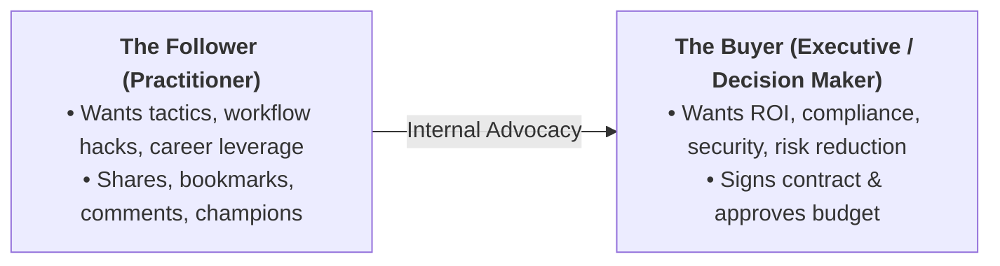

# Jobs-to-be-Done (JTBD) Framework for Audience Research

Demographics describe who someone is on paper; **Jobs-to-be-Done (JTBD)** explain why they take action, buy, share, or stop scrolling.

---

## 1. Why JTBD Beats Demographic Personas

| Traditional Persona (Weak) | Jobs-to-be-Done (Strong) |
|---|---|
| "Sarah, 34, Senior HR Manager, lives in suburbs, loves matcha." | "Trying to stop employees quitting during their first 90 days without spending 20 hours a week on manual check-ins." |
| *Result*: Vague posts about "workplace culture tips". | *Result*: High-converting hooks: *"The 3 questions to ask on day 14 before new hires start browsing LinkedIn."* |

---

## 2. The Three Dimensions of a Job

When someone engages with content or hires a solution, they have three distinct layers of jobs:

1. **Functional Job**: The core task or problem they need to solve.
   - *Example*: Automate Instagram DM replies to lead magnets.
2. **Emotional Job**: How they want to feel (or stop feeling).
   - *Example*: Relieved that inquiries aren't going cold while asleep; confident that leads are nurtured.
3. **Social Job**: How they want to be perceived by peers, bosses, or followers.
   - *Example*: Seen as an innovative, fast-moving creator or agency owner who never drops the ball.

---

## 3. Pains, Desires & Objections

For each segment, map the friction that surrounds the job:

### A. Pains (What blocks the job today)
- Current workarounds that are breaking or exhausting them.
- Time, money, or cognitive bandwidth wasted.
- Fear of making the wrong choice or looking incompetent.

### B. Desires (The desired transformation)
- What does "winning" look like in concrete, measurable terms?
- The Before $\rightarrow$ After transition state:
  - *Before*: Drowning in manual responses, missing deals.
  - *After*: 24/7 automated qualification with qualified bookings appearing on the calendar.

### C. Objections & Skepticism
- Why haven't they solved this yet?
- What bad past experiences or cynical beliefs do they hold?
  - *"Automation makes my brand look spammy."*
  - *"Meta will shadowban my account if I use automation tools."*
  - *"It's too complicated to set up without a developer."*

---

## 4. Buyer vs. Follower Dynamics

In many domains (especially B2B SaaS, agency services, and enterprise tech), the person who follows on social is different from the person who swipes the credit card.

- **Follower-led Content**: Focus on daily execution pains, teardowns, time-savers, and tactical wins.
- **Buyer-led Content**: Focus on macro industry shifts, team efficiency metrics, risk prevention, and business ROI.
