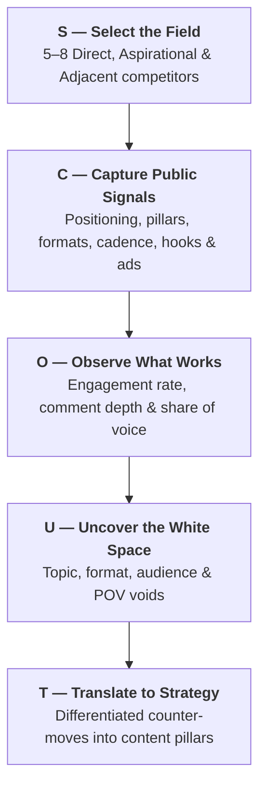

# The SCOUT Framework for Competitive Social Intelligence

The SCOUT methodology turns external competitor monitoring into strategic differentiators for your own brand.

---

## 1. Breakdown of the SCOUT Stages

---

## 2. Stage Execution Guide

### S — Select the Field (~5–8 Accounts)
- **Direct Competitors (2–3)**: Selling a similar product/service to the same target audience.
- **Aspirational Leaders (1–2)**: Top 1% tier accounts in the industry with massive organic loyalty.
- **Adjacent Creators / Brands (2–3)**: Non-competing brands targeting the exact same audience archetype.

### C — Capture Public Signals
Collect public, non-private indicators:
- *Bio & Positioning*: Value prop, searchable name field, link-in-bio destination.
- *Core Content Themes*: The 3–4 topics they consistently post about.
- *Visual Formats*: Carousels, text graphic cards, talking-head reels, high-production video.
- *Publishing Cadence*: Number of posts/week and primary posting time windows.
- *Ad Library Activity*: Active ad creatives in Meta Ad Library / TikTok Creative Center.

### O — Observe What Works
- Calculate median engagement rates across the last 15–20 posts.
- Identify outlier posts (spikes $>3\times$ their median) and dissect *why* they spiked.
- Evaluate comment sentiment (surface emojis vs. deep practitioner discussions).

### U — Uncover the White Space
Identify what competitors **never** talk about or formats they consistently neglect:
- *Topic Gap*: Unaddressed customer pain points or taboo industry truths.
- *Format Gap*: Competitors only do talking-head video; zero detailed carousel breakdowns exist.
- *POV Gap*: Competitors promote standard orthodox advice; contrarian stance is wide open.

### T — Translate to Strategy
Incorporate white space discoveries into your own `content-pillars.md` and `social-strategy.md` in your distinct brand voice.
