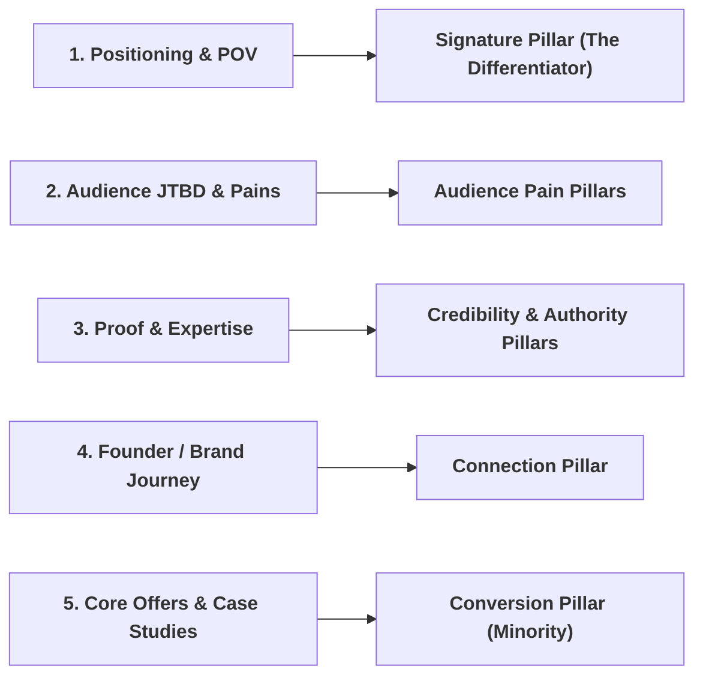

# Deriving Content Pillars from Brand Strategy

How to extract ownable, high-converting pillars directly from `brand-profile.md` and `audience.md`.

---

## 1. The 5 Upstream Sources

### Source 1: Positioning & Point of View $\rightarrow$ The Signature Pillar
- **The Question**: What is the single controversial or distinctive belief this brand stakes out that competitors hesitate to touch?
- *Example*: An email agency's signature pillar: *"Why Newsletter Open Rates are a Fake Metric."*

### Source 2: Audience JTBD & Pains $\rightarrow$ Audience Problem Pillars
- **The Question**: What are the top 3 daily execution headaches described in the audience's verbatim words?
- *Example*: *"Zero-to-One Outbound for Solo Founders."*

### Source 3: Proof & Expertise $\rightarrow$ Credibility Pillars
- **The Question**: What proprietary framework, system, or data does the company possess?
- *Example*: *"Live Workflow Teardowns & Metric Audits."*

### Source 4: Human / Brand Journey $\rightarrow$ Connection Pillar
- **The Question**: What behind-the-scenes engineering decisions or founder lessons build authentic empathy?
- *Example*: *"Building in Public: Lessons from Scaling to $50k MRR."*

### Source 5: Offers & Transformations $\rightarrow$ Conversion Pillar
- **The Question**: What concrete customer transformations and direct lead magnets can be highlighted?
- *Example*: *"Client Case Studies & Lead Magnet Breakdowns (Max 10-15% of mix)."*
