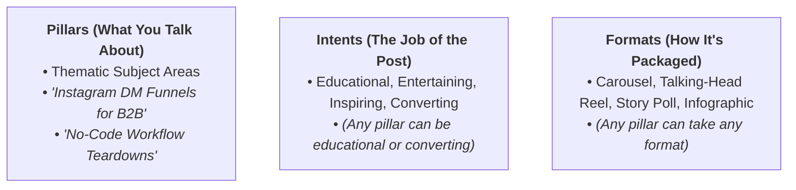

# What Makes a Pillar: Themes vs. Intents vs. Formats

The most frequent error in social content strategy is confusing **Subject Themes** with **Intents** or **Formats**.

---

## 1. The Core Distinction

### Breakdown Comparison

| Type | Examples | Is it a Pillar? | Why? |
|---|---|---|---|
| **Pillar (Theme)** | *"Scaling Outbound Without Cold Calling"* | ✅ **YES** | It's an ownable topic area with endless sub-angles. |
| **Intent** | *"Educational Content"* | ❌ **NO** | That's the psychological goal, not what you're actually talking about. |
| **Format** | *"Behind the Scenes Reels"* | ❌ **NO** | That's the visual delivery format, not a subject. |
| **Pillar (Theme)** | *"Inside our 7-Figure Agency Operations"* | ✅ **YES** | It's a specific ownable subject area (which can use BTS formats). |

---

## 2. The 4-Pillar Test

Before including any candidate theme in `content-pillars.md`, pass it through this 4-step filter:

1. **Ownable**: Can this brand claim genuine authority, proof, or a unique point of view on this topic?
2. **Relevant**: Does this solve a real Job-to-be-Done or pain point identified in `audience.md`?
3. **Strategic**: Does posting about this topic drive awareness, authority, or conversions for our business?
4. **Sustainable**: Can you effortlessly brainstorm 10+ distinct post angles on this topic right now?

> **Rule**: If a candidate fails any single test, discard or refine it.
