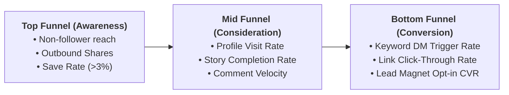

# Goals & KPIs: The 2026 Social Media Reality

Guidelines on metric hygiene, leading vs. lagging indicators, and preventing metric gaming.

---

## 1. Funnel-to-KPI Mapping

---

## 2. Leading vs. Lagging Indicators

| Leading Indicator (Controllable Input) | Lagging Indicator (Business Result) |
|---|---|
| 4 high-value carousels published per week | Total non-follower reach & profile visits |
| 100% of comment replies delivered within 15 minutes | Inbound DM lead volume |
| Hook retention rate at second 3 on Reels | Overall video view duration & viral share rate |

---

## 3. Anti-Gaming Principles & Quality Floors

Whenever a growth or volume KPI is created, it **must** be paired with an opposing quality guardrail to prevent artificial gaming:

| Primary Growth Metric | Quality Guardrail (Floor) | Why It Matters |
|---|---|---|
| Monthly Follower Growth ($+1,000$) | Engagement Rate Floor ($\ge 3.5\%$) | Prevents buying bot followers or low-intent giveaway audiences. |
| Inbound DM Leads (50 leads/mo) | Qualified Lead Threshold ($\ge 70\%$) | Prevents spamming low-value prospects with irrelevant freebies. |
| Reel Views ($100k$ views/mo) | Average Watch Time ($\ge 65\%$) | Prevents clickbait bait-and-switch tactics that hurt brand authority. |

---

## 4. Review Cadence Structure

- **Weekly Review (Tactical)**: Review leading indicators (posting cadence, comment response rate, hook retention).
- **Monthly Review (Strategic)**: Review channel North Stars and check if any Action Thresholds were breached.
- **Quarterly Review (Cascade Audit)**: Re-evaluate business goal alignment and update baselines for the next quarter.
