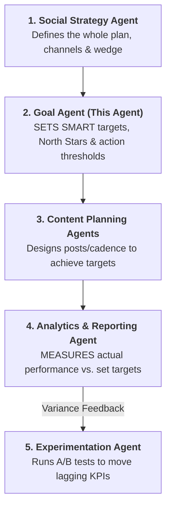

# Scope, Distinctions & Inter-Agent Connections

Understanding how the **Goal Agent** collaborates with upstream strategy and downstream analytics agents.

---

## 1. Clear Agent Role Distinctions

| Agent / Skill | Primary Responsibility | What It Does NOT Do |
|---|---|---|
| **`goal-skill` (This)** | **SETS** measurable targets, North Stars, and thresholds. | Does NOT track or measure day-to-day analytics. |
| **`analytics-and-reporting`** | **MEASURES** actual native performance data against targets. | Does NOT invent the strategic targets. |
| **`social-strategy`** | Sets broad directional vision and 4-fit channel choices. | Does NOT establish granular SMART metrics per post type. |
| **`experimentation`** | Runs tactical hypothesis tests (hooks, timings, formats). | Does NOT define top-level business win conditions. |

---

## 2. Hand-off Protocols

1. **Inbound Hand-off (from `social-strategy`)**:
   - Receive the chosen channels and primary business objective.
   - Convert that objective into the NORTH framework cascade.
2. **Outbound Hand-off (to `batch-content-plan` & `content-pillar`)**:
   - Deliver the weekly output requirements and target conversion mechanisms.
3. **Outbound Hand-off (to `analytics-and-reporting`)**:
   - Hand off the official KPI benchmark ledger and action thresholds for ongoing weekly and monthly monitoring.
