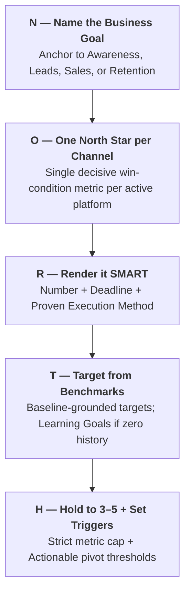

# The NORTH Framework for Social Goal & KPI Setting

The NORTH framework transforms vague social media wishes into concrete, enforceable business win-conditions.

---

## 1. Breakdown of the NORTH Stages

---

## 2. Stage Details

### N — Name the Business Goal
Social metrics must never exist in a silo. Every goal must directly ladder up to one of the 4 core business pillars:
1. **Awareness**: Entering a new category or launching a brand.
2. **Leads**: Building an email list, booking discovery calls, or generating DM inquiries.
3. **Sales**: Driving direct e-commerce checkout or software subscriptions.
4. **Retention**: Cultivating super-advocates and community loyalty.

### O — One North Star per Channel
Every active social platform has a specific role. Assign exactly one primary metric that defines whether the channel is winning:
- *Instagram*: Non-follower reach $\rightarrow$ Save rate (Awareness) or Comment-to-DM conversion rate (Leads).
- *LinkedIn*: Qualified profile views $\rightarrow$ Inbound connection/DM conversion rate (B2B Authority).
- *YouTube*: Average percentage viewed (Retention) $\rightarrow$ Description CTR (Leads).

### R — Render it SMART
Vague: *"Get more leads from Instagram."*  
SMART: *"Generate 40 qualified DM discovery calls per month from Instagram by Month 3 using keyword-triggered lead magnet reels."*
- **Specific**: Qualified DM discovery calls.
- **Measurable**: 40 calls / month.
- **Achievable**: Based on 4 carousels/week producing ~10 calls/week.
- **Relevant**: Ladders directly into quarterly agency pipeline targets.
- **Time-bound**: Deadline set for end of Month 3.

### T — Target from Benchmarks
- **Existing Account**: Set targets relative to the last 90-day baseline (e.g., $+25\%$ quarter-over-quarter).
- **New Account (Zero Data)**: Establish a **30-day Learning Goal** to establish baseline engagement before committing to rigid growth numbers.

### H — Hold to 3–5 + Set Triggers
- Never track more than 3–5 total KPIs across the entire strategy.
- Attach an **Action Threshold** to every KPI:
  - *Trigger*: *"If save rate drops below 3.0% for 2 consecutive weeks $\rightarrow$ audit and revise hook/slide design templates."*
  - *Trigger*: *"If profile visit-to-follow rate drops below 2.5% $\rightarrow$ re-optimize bio and pinned post anchors."*
