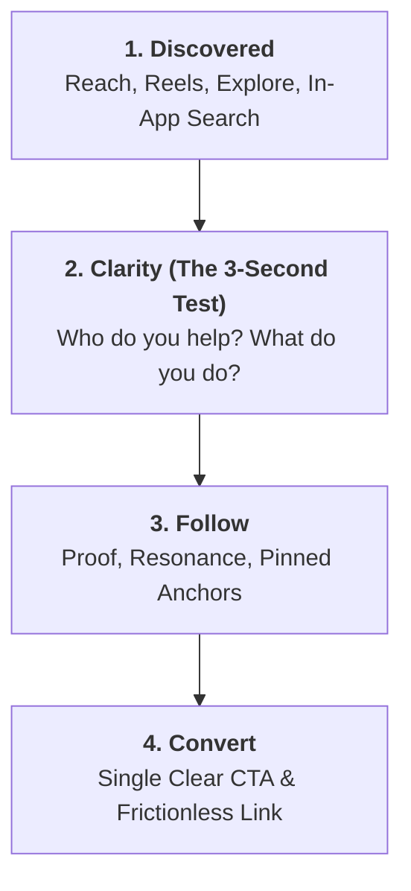

# The Profile Funnel & The 3-Second Test

A social media profile operates identically to an e-commerce landing page. Reach and discovery drive traffic, but the profile architecture determines conversion.



---

## 1. The 3-Second Test

When a user taps your handle from a Reel, Comment, or Search result, they ask 3 subconscious questions before scrolling away:

1. **Who is this for?** *(Is this relevant to me or my business?)*
2. **What do they do / solve?** *(What specific value or perspective do they deliver?)*
3. **Why should I follow right now?** *(Is there credible proof, fresh ongoing value, or a compelling lead magnet?)*

> **Diagnostic**: If any of these three questions takes more than 3 seconds to answer, your profile is leaking up to 70% of potential followers.

---

## 2. Diagnosing Profile Leaks

| Symptom | Funnel Leak | Root Cause & Remedy |
|---|---|---|
| **Low profile visits despite high post impressions** | **Discovered** | Non-searchable name field; weak hook CTA directing viewers back to profile. |
| **High profile visits, very low follow rate (<3%)** | **Clarity / Follow** | Vague "clever" bio, missing niche positioning, lack of credible proof or pinned post anchors. |
| **High followers, zero link clicks or DM leads** | **Convert** | Weak/missing CTA, vague link ("link below ⬇️"), multi-link junk drawer confusing visitors. |
| **Followers drop off after 1–2 weeks** | **Expectation Mismatch** | Bio promises one topic, but ongoing feed posts cover unrelated content. |

---

## 3. Above-the-Fold Real Estate Priority

```
+------------------------------------------------------+
| [Avatar]  @handle                                    |
|           Searchable Name Field | Niche Keyword      |
|                                                      |
| Line 1: Target Audience + Primary Value Wedge        |
| Line 2: Specific Method / What We Do                 |
| Line 3: Hard Proof (Revenue, clients, results)       |
| Line 4: Primary CTA ➔ [Link Destination]             |
+------------------------------------------------------+
| [Follow]  [Message]  [Contact]                       |
+------------------------------------------------------+
| (Highlights: Start Here | Results | Offer | FAQ)     |
+------------------------------------------------------+
| [ Pinned 1: Origin ] [ Pinned 2: Proof ] [ Pinned 3: Offer ] |
+------------------------------------------------------+
```
