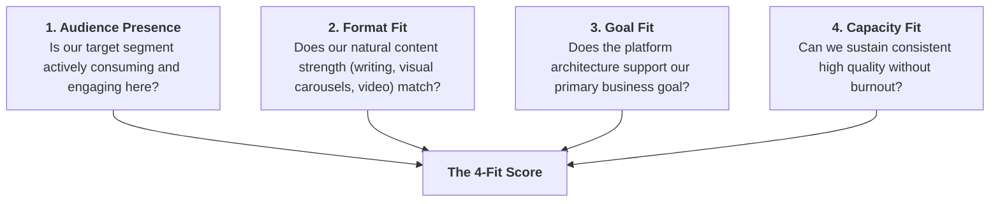

# Channel Selection Framework (The 4-Fit Matrix)

A disciplined framework for deciding which platforms to dominate and which to deliberately ignore.

---

## 1. The 4-Fit Evaluation Matrix

Score candidate platforms (1–5 scale) across these four dimensions:

---

## 2. Channel Role Classification

Assign every platform into one of three distinct tiers:

### Tier 1: Primary Channel (The Anchor) — Pick 1
- **Focus**: 70% of energy and creative bandwidth.
- **Rule**: Native-first creation designed specifically for this algorithm and UX.

### Tier 2: Secondary / Repurposed Channel — Pick 1–2 Max
- **Focus**: 20–30% of energy.
- **Rule**: Content repurposed from the primary channel with light formatting adjustments (e.g., converting an Instagram carousel into a LinkedIn PDF slider).

### Tier 3: Deliberately Dropped Platforms — Name Them & State Rationale
- **Rule**: Zero time spent, or minimal placeholder bio directing traffic to the primary channel.
- *Example*: *"We are dropping TikTok because we have zero video production capacity and our target B2B buyer is on LinkedIn and Instagram."*
