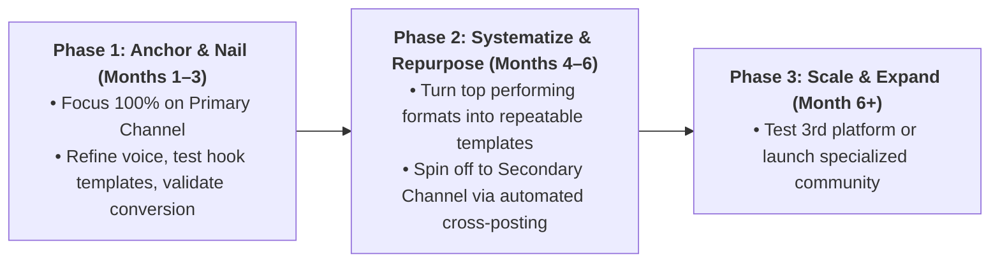

# Operating Model, Strategic Wedge & Cadence Design

How to turn high-level strategy into a sustainable weekly operating system.

---

## 1. Defining the Strategic Wedge

The **wedge** is the specific hook, point of view, or format style that makes the brand's content instantly recognizable in a crowded feed.

### Common Wedge Types:
- **The Contrarian Stance**: Taking an unapologetic, data-backed stance against conventional industry wisdom (e.g., *"Why 90% of lead generation advice on LinkedIn is outdated"*).
- **The Teardown & Reverse-Engineering Angle**: Publicly analyzing top performers, workflows, or campaign failures.
- **The Distinctive Visual Style**: Consistent color palettes, 8-bit retro visuals, bespoke hand-drawn diagrams, or clean typography.
- **The Practitioner's Raw Transparency**: Sharing real internal dashboard numbers, failures, and lessons without fluff.

---

## 2. Realistic Cadence Framework

Consistency over volume. Choose a tier that the team can maintain for 6 months without interruption:

| Capacity Level | Primary Channel Cadence | Stories / Engagement | Repurposed Channel Cadence |
|---|---|---|---|
| **Solo Operator (Low Bandwidth)** | 3 posts/week (e.g., Mon/Wed/Fri) | 3–4 stories/week | 2 repurposed posts/week |
| **Growth Focused (Medium Bandwidth)** | 4–5 posts/week | Daily active stories | 3–4 repurposed posts/week |
| **Dedicated Team (High Bandwidth)** | Daily post (7/week) | Multiple daily story arcs | Daily cross-posting + native threads |

---

## 3. Phased Rollout Roadmap

