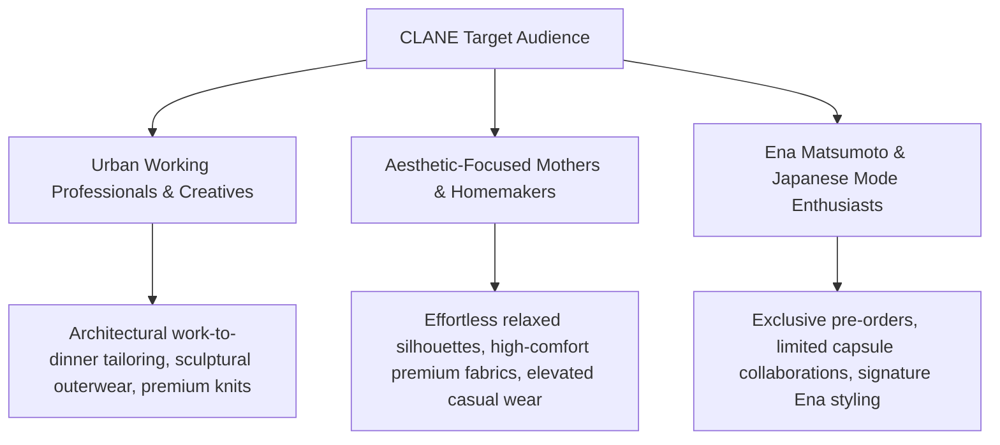
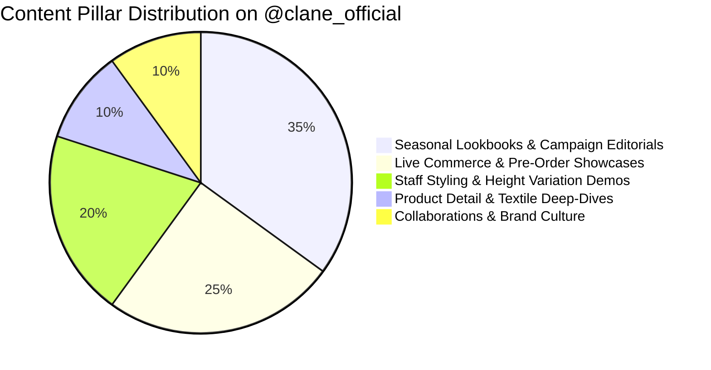
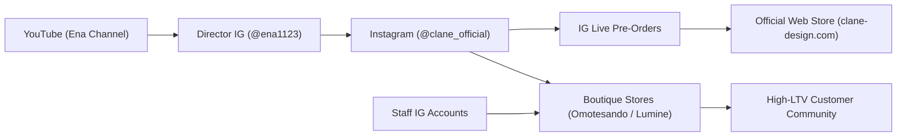

# Brand Profile Analysis: CLANE (CLANE Official)

*Profile Link*: [https://www.instagram.com/clane_official/?hl=en](https://www.instagram.com/clane_official/?hl=en)  
*Analysis Date*: September 1, 2026 | *Status*: Complete Brand Audit & Social Profile Spec

---

## Executive Summary

**CLANE** (CLANE DESIGN Co., Ltd.) is a Tokyo-based contemporary fashion and lifestyle brand founded in 2015 by Creative Director **Ena Matsumoto** (松本恵奈). Anchored in the core design philosophy of **"ORIGINAL STANDARD"**, CLANE reinterprets timeless wardrobe essentials with architectural silhouettes, innovative drapery, premium textures, and contemporary detailing designed for discerning, style-conscious adults.

On Instagram ([@clane_official](https://www.instagram.com/clane_official/?hl=en)), CLANE operates as an **editorial lookbook, high-converting live-commerce hub, and modern Japanese aesthetic benchmark**. It bridges the gap between runway-grade high fashion and wearable urban utility, utilizing director-led storytelling, height-inclusive staff styling, and immersive pre-order exhibitions (*先行予約会*) to cultivate a fiercely loyal, high-LTV customer base.

---

## 1. Instagram Profile & Funnel Diagnostics

| Element | Specification & Observation | Strategic Diagnostic |
| :--- | :--- | :--- |
| **Handle / Account** | `@clane_official` | Verified, authoritative primary brand handle. |
| **Searchable Name** | **CLANE (クラネ)** *(Apparel & Fashion / Contemporary Tokyo Brand)* | Dual-script optimized (Latin alphabet + Japanese Katakana) for domestic and international discovery. |
| **Followers / Engagement** | ~400K+ Highly Engaged Fashion Enthusiasts | High-intent, fashion-literate audience with strong organic saves, pre-order traffic, and live broadcast viewership. |
| **Bio & Value Proposition** | *"ORIGINAL STANDARD — A special piece that can be worn for a long time."* Official updates on new arrivals, pre-orders, store information, and live styling schedules. | Clear, authoritative, luxury-adjacent value proposition focusing on timeless longevity and refined individualism. |
| **Primary Link / CTA** | `clane-design.com` (Direct integration with official e-commerce, lookbooks, pre-order reservations, and boutique shop list) | Frictionless funnel directing high-intent social traffic to new seasonal drops and pre-order reservation windows. |
| **Story Highlights** | • PRE-ORDER • NEW ARRIVAL • LIVE ARCHIVE • COLLABORATIONS • STORES • REEL STYLING | Clean, categorized highlight taxonomy functioning as a secondary navigation bar for collections and retail touchpoints. |
| **3-Second Test** | **Passed** | Instantly communicates high-end Japanese contemporary minimalism, architectural tailoring, and sophisticated everyday luxury. |

---

## 2. Core Brand Profile (Framework Alignment)

### 2.1 Identity & One-Liner
- **Business Name**: CLANE / CLANE DESIGN Co., Ltd.
- **Creative Director**: Ena Matsumoto (松本恵奈)
- **One-Sentence Description**: A contemporary Tokyo fashion brand that transforms standard wardrobe staples into distinctive, enduring statement pieces through architectural tailoring, tactile textile innovation, and effortless modern silhouettes.
- **Category**: Contemporary Womenswear & Menswear / Tokyo Designer Ready-to-Wear / Premium Minimalist Fashion
- **Core Philosophy & Tagline**:
  - *"ORIGINAL STANDARD"*
  - *"特別な一枚 (A Special Single Piece)"* — Designed to be treasured and worn across seasons rather than discarded after fleeting trend cycles.

### 2.2 Positioning & Point of View
- **The Core Differentiator**: **Architectural Form Meets Everyday Wearability**. While traditional fast-fashion brands push disposable trend turnover and high-end luxury houses remain financially out of reach, CLANE occupies the **"Affordable High-Contemporary"** sweet spot: premium fabrics, dramatic yet wearable silhouettes (balloon sleeves, cocoon coats, layered knitwear, sculptural collars), and Japanese artisan precision.
- **Staked-Out Beliefs (What CLANE Fights For)**:
  - True style lies in modernizing foundational "standard" silhouettes, not chasing gimmicky micro-trends.
  - Clothing should empower the wearer with effortless confidence, structural grace, and tactile comfort.
  - Transparency and relatable styling (showing pieces on diverse heights and real staff) are essential for high-end digital commerce.
- **Rejected Norms (What CLANE Fights Against)**:
  - Flimsy fast-fashion polyester garments meant to be thrown away after one season.
  - Hyper-sexualized or uncomfortable women’s tailoring that restricts natural movement.
  - Sterile, detached fashion marketing with no connection between designer, staff, and consumer.

---

## 3. Target Audience & Attention Map



### 3.1 Detailed Buyer Personas

1. **The Tokyo Urban Professional & Creative (26–42 yrs)**:
   - *Profile*: Designers, marketing managers, architects, creative agency directors, boutique executives.
   - *Attention Triggers*: Tailored wide-leg trousers, sculptural trench coats, jacquard patterned blouses, monochrome styling.
   - *Core Pain Point*: Wants runway-level design sophistication for corporate and social settings without paying European luxury couture prices.

2. **The Modern Aspirational Minimalist (25–38 yrs)**:
   - *Profile*: Values quality over quantity; curates a capsule wardrobe of durable, versatile, distinctive staples.
   - *Attention Triggers*: Garment movement reels, 360-degree fabric drape showcases, layering tutorials for seasonal transitions.
   - *Core Pain Point*: Frustrated by generic mall brands that lack distinctive silhouette flair or degrade after washing.

3. **The Global J-Fashion & Mode Collector (International / Asia-Pacific)**:
   - *Profile*: Discerning fashion lovers in Taiwan, Hong Kong, Seoul, Singapore, North America seeking Tokyo mode aesthetics.
   - *Attention Triggers*: Lookbook editorials, collaboration announcements (e.g., Fragment Design, Minami Tanaka, RAMIDUS, SPEEDO, KIJIMA TAKAYUKI), pre-order countdowns.

---

## 4. Voice, Tone & Visual Lexicon

### 4.1 Voice Dimensions
- **Tone**: Understated, elegant, design-articulate, poised, authentic, and subtly welcoming.
- **Formality (1–5)**: `3.8 / 5` — Polished Japanese *Keigo* (polite language) blended with intimate, accessible styling commentary.
- **Humor & Wit (1–5)**: `1.5 / 5` — Focuses on aesthetic composure, tactile texture, and silhouette appreciation rather than viral humor or meme formats.
- **Copy Structure**:
  - Clear collection identifiers (Season / Drop Title).
  - Garment structural highlights (fabric composition, pleating, volume control, styling versatility).
  - Release dates, pre-order timelines, and store availability links.

### 4.2 Visual DNA & Aesthetic Standards
- **Color Palette**: Muted neutrals, warm ecru, deep charcoal, olive drab, soft mocha, clay taupe, slate navy, and intentional seasonal accent hues (terracotta, pistachio, butter yellow).
- **Lighting & Composition**: Soft natural light, clean architectural backdrops (concrete, wood, warm gallery interiors), low-contrast luxury editorial framing.
- **Movement & Texture**: Close-up macro shots of jacquard weaves, knit ribbing, seam finishing, and fluid video clips capturing fabric drape in motion.

---

## 5. Content Pillars & Grid Strategy on Instagram



### 5.1 Pillar Breakdown

1. **Seasonal Lookbooks & Campaign Editorials (35%)**:
   - High-fashion studio and on-location editorial shoots setting the conceptual narrative for Spring/Summer and Autumn/Winter.
   - Curated grid layout featuring balanced full-body portraits, mid-shots, and artistic negative space.
2. **Live Commerce & Pre-Order Broadcasts (*先行予約会*) (25%)**:
   - Instagram Live sessions hosted by Ena Matsumoto and the design team introducing upcoming unreleased collections.
   - Real-time commentary answering audience questions regarding fit, bust/hip measurements, layering with coats, and color choices.
3. **Staff Styling & Multi-Height Demos (20%)**:
   - Outfits modeled by boutique staff across different height brackets (e.g., 152cm / 158cm / 168cm) to eliminate sizing anxiety for online shoppers.
   - Cross-promotion of store staff personal accounts (Omotesando Hills, Lumine Shinjuku, Lucua Osaka, Lumine Yokohama).
4. **Product Detail & Craftsmanship Cutaways (10%)**:
   - Focus on original hardware buttons, custom jacquard patterns, pleat stitching, and reversible jacket mechanics.
5. **High-Profile Collaborations & Pop-ups (10%)**:
   - Capsule launches with cultural tastemakers and renowned labels (Minami Tanaka, Hiroshi Fujiwara / Fragment, Kijima Takayuki, Speedo).

---

## 6. Omnichannel Ecosystem & Growth Engine



- **The Director Flywheel**: Ena Matsumoto’s personal platform (`@ena1123` with 600K+ followers, and YouTube's *Ena Channel*) acts as a massive top-of-funnel discovery vehicle, providing behind-the-scenes glimpses into sample making, wardrobe styling, and lifestyle curation.
- **Pre-Order (*先行予約*) Conversion Machine**: By hosting pre-order exhibitions months ahead of general release, CLANE minimizes inventory risk, forecasts production demand accurately, and creates extreme anticipation.
- **Physical Flagship Synergy**: Flagship presences in premier Tokyo shopping destinations (Omotesando Hills B1F, Shinjuku Lumine 2 2F, Lumine Yokohama, Lucua Osaka) provide tactile, white-glove validation of the digital aesthetic.

---

## 7. Competitive Benchmark & SWOT Analysis

```
┌─────────────────────────────────────────────────────────────────────────┐
│ CLANE vs. CONTEMPORARY J-MODE COMPETITORS                               │
├───────────────────┬─────────────────────────────────────────────────────┤
│ Brand             │ Key Distinction vs. CLANE                           │
├───────────────────┼─────────────────────────────────────────────────────┤
│ **CLANE**         │ "ORIGINAL STANDARD": Balanced sculptural luxury with│
│                   │ high daily wearability + massive director pull.     │
│ **TODAYFUL**      │ More relaxed, bohemian-casual, earthy lifestyle.    │
│ **ENFÖLD**        │ Higher price tier, avant-garde art-collector cuts.  │
│ **RIM.ARK**       │ Sharp geometric mode, strictly monochrome palette.  │
│ **Ameri VINTAGE** │ High-ornamentation, vintage-inspired mixed prints.  │
└───────────────────┴─────────────────────────────────────────────────────┘
```

### Strengths
- **Massive Organic Director & Staff Reach**: High trust and authentic connection built through direct live streams and YouTube.
- **Distinctive Design Signature**: Instantly identifiable silhouette language (puffy drop-shoulders, sculptural collars, cocoon coats).
- **Proven Pre-Order Model**: Exceptional cash flow efficiency and near-zero inventory deadstock.

### Opportunities for Social Optimization
- **Multilingual Captions & Global Shipping Promotion**: Adding structured English/Traditional Chinese summary overlays on Reels to capture the rapidly growing overseas luxury customer base.
- **Interactive Styling Carousels**: "1 Piece, 3 Ways" multi-slide format showing how to transition a statement CLANE coat from boardroom to weekend casual.
- **Dedicated Sound & ASMR Styling**: Crisp fabric sounds (unboxing, zip, button fastening) to tap into sensory fashion trends on Instagram Reels.

---

## 8. Actionable Profile Optimization Blueprint for `@clane_official`

```
┌──────────────────────────────────────────────────────────────────────────┐
│ PROFILE SPECIFICATION BLUEPRINT                                          │
├──────────────────────────────────────────────────────────────────────────┤
│ Name Field:   CLANE / クラネ | Contemporary Fashion & Mode               │
│ Bio:          ORIGINAL STANDARD                                          │
│               「特別な一枚」を重視し、長く愛用できる大人のスタイルを提案。 │
│               Director: @ena1123                                         │
│               New Arrivals, Pre-Orders & Store Info 👇                   │
│ Link:         clane-design.com                                           │
│ Highlights:   • 26AW PRE-ORDER  • NEW ARRIVAL  • IG LIVE ARCHIVE         │
│               • STAFF STYLING   • STORES & POP-UP  • COLLAB              │
└──────────────────────────────────────────────────────────────────────────┘
```
