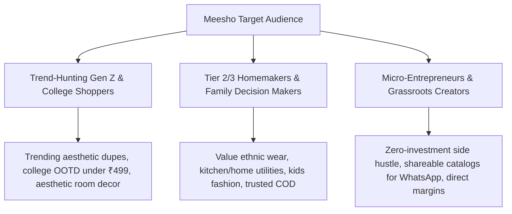
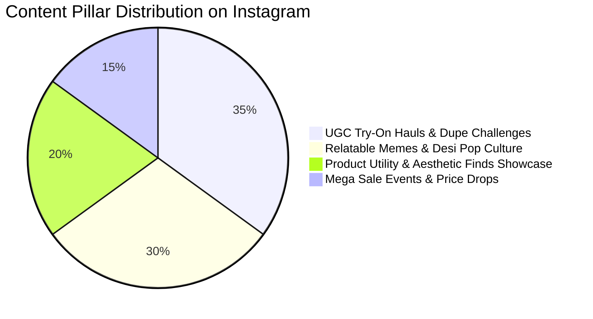
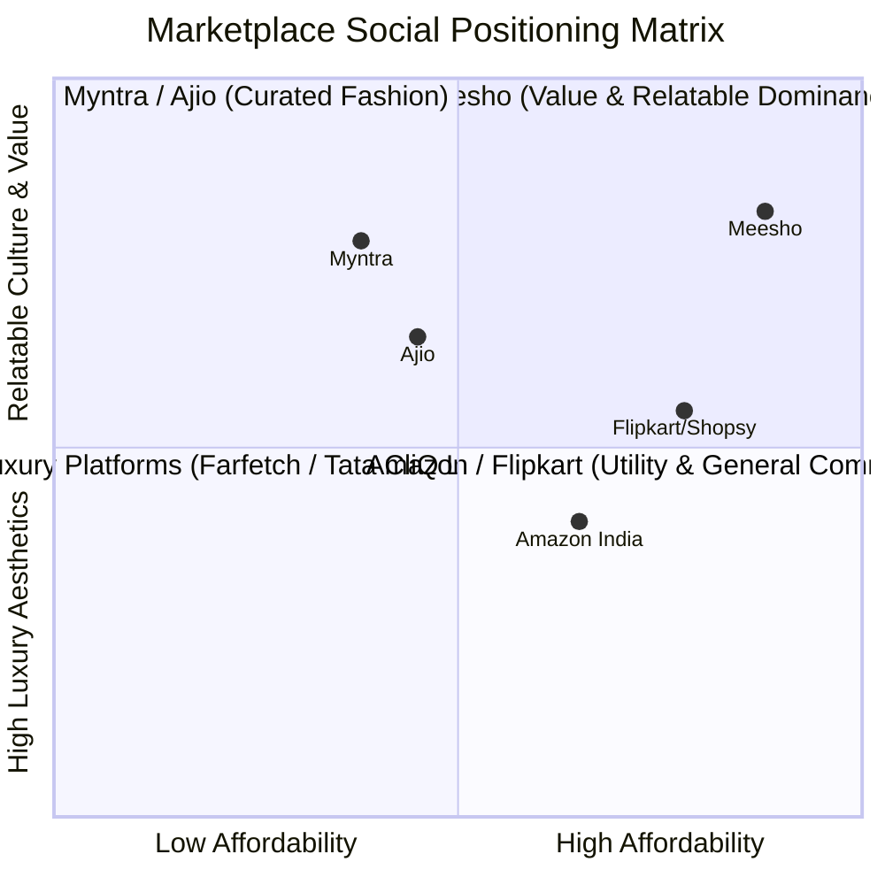

# Brand Profile Analysis: Meesho

*Profile Link*: [https://www.instagram.com/meesho.app__/?hl=en](https://www.instagram.com/meesho.app__/?hl=en)  
*Analysis Date*: August 30, 2026 | *Status*: Complete Brand Audit & Social Profile Spec

---

## Executive Summary

**Meesho** is India’s benchmark value e-commerce marketplace and social commerce pioneer, dedicated to democratizing internet commerce for "Bharat" (Tier 2, 3, and 4+ cities, alongside value-conscious metro shoppers). On Instagram ([@meesho.app__](https://www.instagram.com/meesho.app__/?hl=en)), the brand breaks away from the ultra-glossy, unattainable luxury aesthetics of legacy fashion retailers. Instead, it positions itself as the **unapologetically accessible, budget-glam, and culturally relatable shopping buddy**.

Its social presence functions as a high-velocity discovery engine and meme hub where affordable trend culture, viral price anchors (e.g., *"Outfits Under ₹299"*), and grassroots creator hauls demonstrate its core thesis: **"High fashion and everyday lifestyle don't need a high price tag."**

---

## 1. Instagram Profile & Funnel Diagnostics

| Element | Specification & Observation | Strategic Diagnostic |
| :--- | :--- | :--- |
| **Handle / Account** | `@meesho.app__` / `@meeshoapp` | Recognized social commerce presence targeted at mobile-first digital shoppers. |
| **Searchable Name** | **Meesho** *(Shopping & Retail / Value Fashion & Lifestyle)* | Optimized for high search intent around budget shopping, trendy fashion, and home utility. |
| **Followers / Following** | High-reach consumer & reseller community | Scaled audience with a heavy concentration of Gen-Z, millennial budget stylists, and homemakers. |
| **Bio & Value Proposition** | *"India’s favourite online shopping destination. Sahi Sahi Lagaya Hai! Download the app for unbeatable deals."* | Clear, benefit-driven value prop emphasizing affordability, wide catalog variety, and instant download incentive. |
| **Primary Link / CTA** | `meesho.com` / App Download Link-in-Bio / Curated Collection Storefronts | Frictionless deep-linking directly into product categories, trending viral picks, and seasonal sale carts. |
| **3-Second Test** | **Passed** | Immediately signals vibrant affordability, relatable Indian pop culture, and low-friction shopping. |

---

## 2. Core Brand Profile & Strategic Positioning

### 2.1 Identity & One-Liner
- **Business Name**: Meesho
- **One-Sentence Description**: A value-first multi-category e-commerce and social commerce marketplace enabling millions of consumers, small businesses, and resellers to buy and sell quality fashion, beauty, home decor, and essentials at ultra-affordable price points.
- **Category**: Value E-Commerce / Social Commerce / Fast-Fashion & Lifestyle Marketplace
- **Core Slogans & Campaign Taglines**:
  - *"Sahi Sahi Lagaya Hai"* (Fair pricing / No bargaining needed)
  - *"Meesho Pe Hai Sab Kuch"* (Everything is on Meesho)
  - *"Har Ghar Meesho"*
  - *"Trend Under Budget"*

### 2.2 Positioning & Point of View
- **The Core Differentiator**: **Radical Affordability + Unfiltered Relatability**. While Myntra and Ajio target aspirational metro audiences with premium Western labels, and Amazon/Flipkart focus on logistics and electronics, Meesho dominates **unbranded and value-branded lifestyle items, ethnic wear, accessories, and home utility** with direct-from-manufacturer pricing.
- **Staked-Out Beliefs (What Meesho Fights For)**:
  - Looking stylish and decking out your home shouldn't be reserved for high-income households.
  - Social commerce and micro-entrepreneurship should empower Tier-2/3/4 creators, homemakers, and regional sellers.
  - Relatable, real-people creator content (UGC) is 10x more trustworthy than studio-filtered celebrity perfection.
- **Rejected Norms (What Meesho Fights Against)**:
  - Overpriced fast-fashion markups and snobbish retail pricing.
  - Complex, intimidating shopping experiences that alienate non-metro digital natives.
  - Sterile corporate brand voices with zero regional cultural nuance.

---

## 3. Target Audience & Attention Map



### 3.1 Audience Personas

1. **The Trend-Seeking Gen Z / College Budget Fashionista**:
   - *Demographics*: 16–25 years old, Tier 1 & Tier 2 colleges, mobile-first Instagram and Reels power users.
   - *Attention Triggers*: "Pinterest vs Meesho" look-alikes, college wardrobe hauls under ₹500, Y2K aesthetics on a shoestring budget.
   - *Core Pain Point*: Wants to participate in fast micro-trends without draining monthly pocket money or allowances.

2. **The Smart Value Homemaker & Family Manager**:
   - *Demographics*: 25–45 years old, Tier 2, 3, and 4 cities, budget-conscious household shopper.
   - *Attention Triggers*: Festive saree hauls, functional kitchen organizing gadgets, kidswear combos, festive decor glow-ups.
   - *Core Pain Point*: Wants maximum utility, quality assurance, and easy returns without paying high mall prices.

3. **The Micro-Influencer & Aspiring Reseller**:
   - *Demographics*: Tier 2/3 creators, students, and home entrepreneurs looking to build a social income stream.
   - *Attention Triggers*: Affiliate codes, easy catalog sharing to WhatsApp/Telegram, unboxing authenticity.

---

## 4. Voice, Tone & Visual Lexicon

### 4.1 Voice Dimensions
- **Tone**: Witty, conversational, warm, hyper-relatable, celebratory, and culturally embedded (desi pop culture).
- **Formality (1-5)**: `1.8 / 5` — Highly casual, conversational Hinglish, like a savvy best friend sharing shopping finds in your DMs.
- **Humor & Wit (1-5)**: `4.5 / 5` — High meme literacy, reactive topical humor, self-deprecating online shopping banter.
- **Copy Structure**: Snappy 1-line hooks in captions, price transparency upfront, product codes/search IDs clearly listed, and relatable conversational prompts.

### 4.2 Lexicon & Linguistic Palette
- **Preferred Words**: *Loot, under ₹199, aesthetic finds, dupe, styling hack, Meesho haul, Sahi Sahi, trending, steal deal, glow up, parcel unboxing, wardrobe refresh.*
- **Banned / Avoided Words**: *Exclusive luxury, haute couture, exorbitant, members-only, high-society, overly complex technical jargon.*

---

## 5. Content Pillars & Grid Strategy on Instagram



### 5.1 Pillar Breakdown

1. **UGC Try-On Hauls & "Pinterest on a Budget" (35%)**:
   - Micro-creator Reels testing outfits from unboxing to wearing.
   - High-energy formats: *"Recreating Bollywood / Pinterest looks under ₹999"*, *"Honest Meesho kurti haul"*.
   - Clear on-screen product codes (`Code: s-123456`) and transparent pricing overlays.

2. **Relatable Desi Memes & Situational Comedy (30%)**:
   - Relatable sketches on online shopping addiction, tracking parcel deliveries, bargaining with parents, and end-of-month salary memes.
   - Leverages trending audio and viral regional meme templates to drive organic shares.

3. **Curated Aesthetic Finds & Utility Demos (20%)**:
   - High-aesthetic short clips showing room decor transformations, aesthetic stationery, and kitchen space-saving hacks.
   - Visually satisfying ASMR unboxings and organizing reels.

4. **Mega Sale Buzz & Interactive Gamification (15%)**:
   - Countdown hype for flagship sales (Maha Indian Savings Sale, festive discounts).
   - "Guess the Price" trivia, flash deal drops, and giveaway campaigns.

---

## 6. SWOT & Competitive Profile Analysis



### Strengths
- **Massive Viral Relatability**: The content feels organic, human, and fun rather than a pushy corporate catalogue.
- **Unbeatable Price Transparency**: Always shows prices and product search codes upfront, removing buyer friction.
- **Extensive Nano/Micro-Influencer Army**: Collaborates with thousands of regional creators across language spheres.

### Weaknesses / Gaps
- **Perceived Quality Skepticism**: Value fashion naturally carries buyer anxiety about fabric durability and sizing discrepancies.
- **Comment Section Customer Support Friction**: High-volume complaints around delivery or refunds occasionally spill over into organic post comments.

### Strategic Opportunities
- **"Quality Verification" Content Series**: Creating transparent content showing fabric testing, durability checks, and verified review stamps to alleviate quality doubts.
- **Curated Style Edits by Rising Stylists**: Partnering with emerging indie stylists to show high-taste curation from budget pieces.

---

## 7. Actionable Profile Optimization Blueprint for `@meesho.app__`

```
┌──────────────────────────────────────────────────────────────┐
│ PROFILE SPECIFICATION BLUEPRINT                              │
├──────────────────────────────────────────────────────────────┤
│ Name Field:  Meesho | Fashion, Home & Trending Finds         │
│ Bio:         ✨ Unbeatable fashion & lifestyle finds under ₹499│
│              🛍️ Sahi Sahi Lagaya Hai!                         │
│              📦 Easy Returns & Cash on Delivery Available     │
│              👇 Shop viral picks & download the app           │
│ Link:        meesho.com/download                             │
│ Highlights:  • Trending Hauls • Under ₹299 • Aesthetic Home   │
│              • Festive Looks  • App Hacks  • Customer Love    │
└──────────────────────────────────────────────────────────────┘
```
