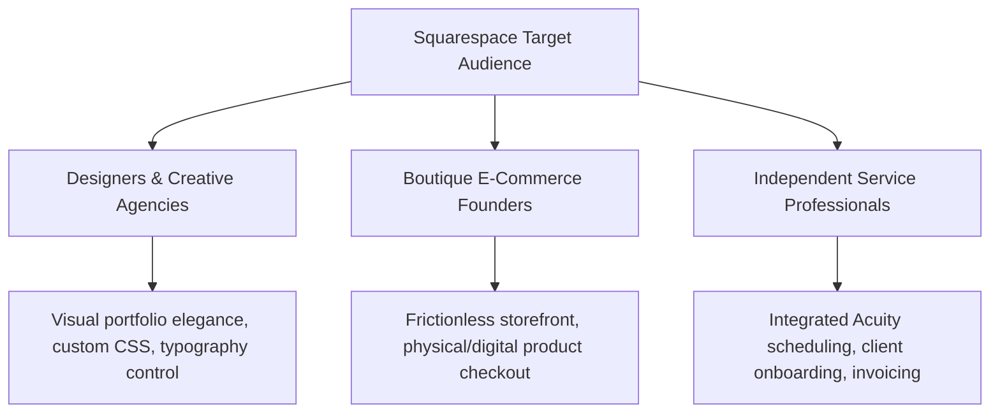
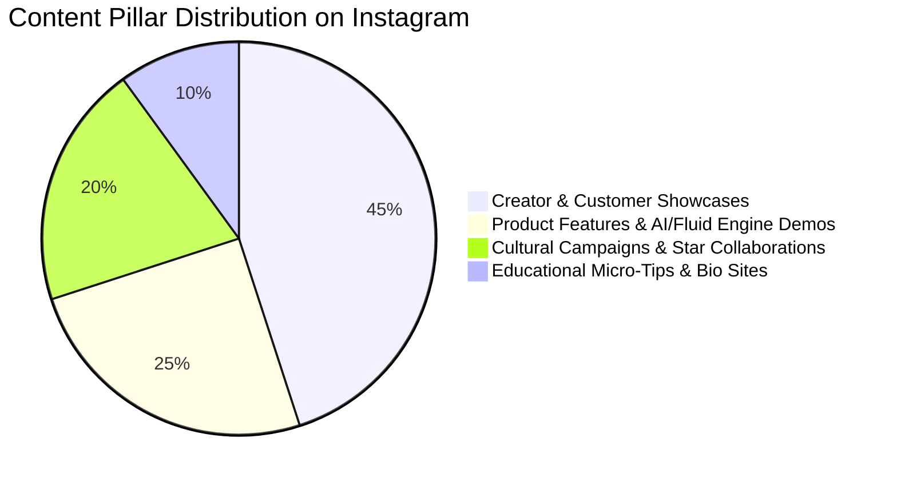

# Brand Profile Analysis: Squarespace

*Profile Link*: [https://www.instagram.com/squarespace/?hl=en](https://www.instagram.com/squarespace/?hl=en)  
*Analysis Date*: August 30, 2026 | *Status*: Complete Brand Audit & Social Profile Spec

---

## Executive Summary

Squarespace is a global website building, commerce, and digital presence platform tailored for creators, entrepreneurs, designers, and modern businesses. On Instagram ([@squarespace](https://www.instagram.com/squarespace/?hl=en)), the brand positions itself not as a sterile SaaS utility, but as an **editorial design icon** and **creative enabler**.

Its social presence functions as a high-end curated gallery where customer craftsmanship, bespoke typography, and cinematic branding prove the core thesis: **"A website makes it real."**

---

## 1. Instagram Profile & Funnel Diagnostics

| Element | Specification & Observation | Strategic Diagnostic |
| :--- | :--- | :--- |
| **Handle** | `@squarespace` | Verified, exact-match tier-1 branding. |
| **Searchable Name** | **Squarespace** *(CMS / Website & Commerce Platform)* | Clean, highly authoritative. |
| **Followers / Following** | ~450K Followers \| 9 Following | High prestige ratio; selective following focused on internal initiatives. |
| **Post Count** | ~150 Curated Posts | Highly manicured grid; low-performing or seasonal campaign posts are regularly archived to maintain editorial purity. |
| **Primary Link** | `bio.site/squarespace` / `squarespace.com` | Utilizes their proprietary **Bio Sites** product to model the link-in-bio user journey for creators. |
| **3-Second Test** | **Passed** | Immediately conveys high-aesthetic web design and creative commerce. |

---

## 2. Core Brand Profile (Framework Alignment)

### 2.1 Identity & One-Liner
- **Business Name**: Squarespace
- **One-Sentence Description**: An all-in-one design and commerce platform that empowers entrepreneurs and creative professionals to build standout websites, sell products or services, and scale their digital footprint.
- **Category**: Website Builder / Creative CMS / E-Commerce & Creator Tools
- **Core Slogans / Hooks**:
  - *"A website makes it real."*
  - *"Everything to sell anything."*

### 2.2 Positioning & Point of View
- **The Core Differentiator**: Uncompromising visual design and editorial aesthetics. While Shopify focuses on transactional backends and WordPress on open-source complexity, Squarespace wins on **effortless design elegance and creative authority**.
- **Staked-Out Beliefs (What Squarespace Fights For)**:
  - Good design is not a luxury; it is the fundamental driver of business credibility.
  - Creators and small businesses deserve the same visual prestige as Fortune 500 brands.
  - An online presence must be holistic: website, domains, bio-link, e-commerce, and client scheduling under one roof.
- **Rejected Norms (What Squarespace Fights Against)**:
  - Clunky, amateur-looking template designs.
  - Fragmented tech stacks requiring 15 separate plugins to run a simple boutique business.
  - Boring, transactional corporate SaaS marketing.

---

## 3. Target Audience & Attention Map



1. **The Visual Creative & Agency Designer**:
   - *Demographics*: Photographers, architects, interior designers, art directors, graphic artists.
   - *Attention Triggers*: High-fashion visuals, architectural grid layouts, crisp typography, minimalist portfolios.
   - *Core Pain Point*: Existing tools make their work look generic or take too much code maintenance.

2. **The Modern Independent Founder & Artisan**:
   - *Demographics*: Boutique fashion labels, specialty food/beverage makers, lifestyle brand creators.
   - *Attention Triggers*: Creator origin stories, packaging design, seamless shop checkout demos.
   - *Core Pain Point*: Needs an e-commerce setup that looks world-class without a $50k agency budget.

3. **The High-End Service Provider & Consultant**:
   - *Demographics*: Coaches, therapists, event planners, creative consultants.
   - *Attention Triggers*: Scheduling integration, professional lead capture, smooth mobile experience.

---

## 4. Voice, Tone & Visual Lexicon

### 4.1 Voice Dimensions
- **Tone**: Understated, confident, design-literate, inspiring, concise.
- **Formality (1-5)**: `3.5 / 5` — Polished, editorial, smart without being stuffy.
- **Humor & Wit (1-5)**: `2.5 / 5` — Dry, cinematic wit (as seen in Martin Scorsese / Super Bowl campaigns), never goofy meme bait.
- **Copy Structure**: Short 1-2 sentence captions, crediting the creator/business, ending with a soft exploratory CTA.

### 4.2 Lexicon Guide
- **Preferred Words**: *Craft, vision, curate, make it real, build, launch, design, standalone, fluid, distinct, aesthetic, presence.*
- **Banned / Avoided Words**: *Cheap, budget, quick hack, growth hack, dropshipping, generic hustle slang.*

---

## 5. Content Pillars & Grid Strategy on Instagram



1. **Creator & Customer Showcases (45%)**:
   - Real Squarespace users (photographers, ceramicists, culinary creators, indie musicians).
   - High production video tours of their physical workspace transitioning to their online storefront/portfolio.
2. **Product Innovation & Fluid Engine (25%)**:
   - Sleek UI walkthroughs showing drag-and-drop flexibility, custom typography, AI generation capabilities, and mobile responsiveness.
3. **High-Impact Brand Campaigns & Cultural Partnerships (20%)**:
   - Hollywood directors, Grammy-winning artists, and cultural tastemakers demonstrating creative entrepreneurship.
4. **Creator Enablement & Link-in-Bio (10%)**:
   - Educational snippets on setting up `Bio Sites`, monetization, and branding fundamentals.

---

## 6. SWOT & Competitive Profile Analysis

### Strengths
- **Aesthetic Benchmark**: The most visually sophisticated feed in the entire website/SaaS category.
- **Organic Social Proof**: Every customer showcase acts as an undeniable product demonstration.
- **Own-Product Dogfooding**: Uses `Bio Sites` directly in the Instagram bio to drive product adoption.

### Weaknesses / Gaps
- **High Barrier to Entry Perception**: The feed is so polished that non-designer small businesses (e.g., local plumbers, electricians) might feel Squarespace is "only for luxury creatives."
- **Low Direct Engagement Bait**: Does not rely on controversial takes or comment-farming carousels, which results in steady rather than explosive comment counts.

### Strategic White Space (Opportunity for Optimization)
- **Direct Educational Carousels**: Introducing tactical, multi-slide design teardowns ("3 Typography Mistakes Ruining Your Conversion Rate") to capture search traffic and saves.
- **Community Templates / Remixes**: Showcasing before-and-after template transformations by real non-technical users to demystify accessibility.

---

## 7. Actionable Profile Optimization Blueprint for `@squarespace`

```
┌──────────────────────────────────────────────────────────────┐
│ PROFILE SPECIFICATION                                        │
├──────────────────────────────────────────────────────────────┤
│ Name Field:  Squarespace | Websites & Commerce               │
│ Bio:         Everything to sell anything.                    │
│              A website makes it real.                        │
│              Explore templates, creator stories & tools 👇   │
│ Link:        bio.site/squarespace                            │
│ Highlights:  • Templates  • Customer Stories  • AI Tools     │
│              • Bio Sites  • Domains & Email                  │
└──────────────────────────────────────────────────────────────┘
```
