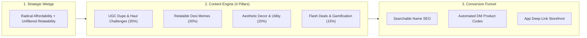
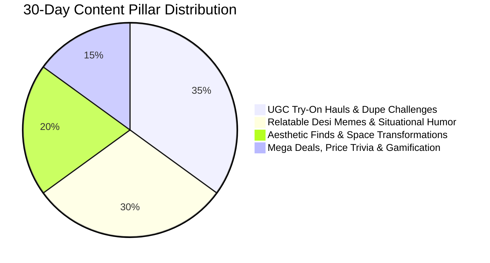
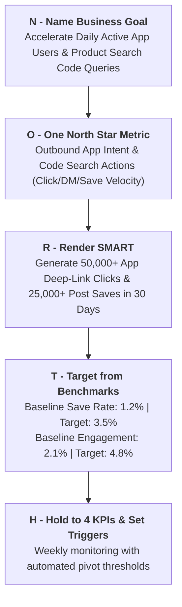
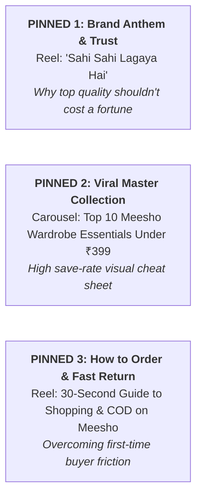
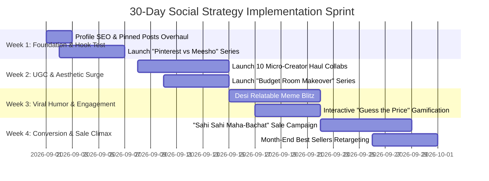
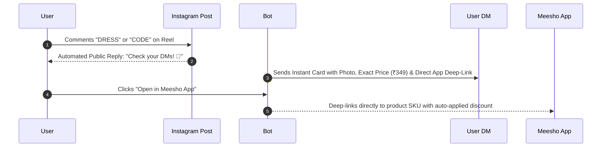

# Meesho: Social Strategy, Goals & 30-Day Execution Playbook

*Brand*: **Meesho**  
*Primary Channel*: **Instagram ([@meesho.app__](https://www.instagram.com/meesho.app__/?hl=en))**  
*Execution Horizon*: **30-Day Intensive Growth & Conversion Sprint**  
*Status*: Active Strategic Plan & Execution Roadmap

---

## Executive Overview

This document outlines the **Social Media Strategy**, **NORTH-framework Goal Cascade**, **Profile Optimization Blueprint**, and a **Turnkey 4-Week Content Execution Calendar** for **Meesho**.

While Meesho possesses massive organic brand recall in Bharat, the core objective of this 30-day strategy is to turn passive social scrollers into **active app downloaders, repeat catalog searchers, and high-frequency buyers** by weaponizing **extreme price anchors**, **authentic UGC try-ons**, and **viral desi meme hooks**.

---

# Part 1: Social Media Strategy



## 1.1 Core Strategic Objective
- **Primary Objective**: **Direct App Acquisition & Search Code Activation** (Driving profile visitors and Reel viewers to search exact product codes on the Meesho app or download directly).
- **Secondary Objective**: **Quality Demystification & Trend Accessibility** (Overcoming buyer skepticism around fabric/durability while cementing Meesho as the #1 budget trend destination).

## 1.2 The Strategic Wedge
> **The Wedge**: *"Luxury Aesthetics at Local Market Pricing."*  
> While competitors showcase ₹3,000+ aspirational outfits in high-fashion studio environments, Meesho proves that you can recreate viral Pinterest & celebrity aesthetics for **under ₹499**, validated by real creators in relatable everyday settings.

## 1.3 Channel Focus & Content Pillars



### Pillar 1: UGC Try-On Hauls & Dupe Challenges (35% / ~5 posts per week)
- **Concept**: Real creators opening parcels, reviewing fabric/fit, and styling outfits side-by-side with high-end brands.
- **Key Formats**: *"Recreating Zara/Pinterest look under ₹599"*, *"Honest Meesho kurti review — hit or miss?"*, *"College outfits for Monday to Friday under ₹1,500 total"*.
- **Direct Conversion Anchor**: Every post prominently overlays the 6-character product search code (`Code: s-382910`) on screen and in the first caption line.

### Pillar 2: Relatable Desi Memes & Situational Humor (30% / ~4 posts per week)
- **Concept**: Hyper-relatable comedy skits and trending meme formats around everyday Indian shopping habits.
- **Key Formats**: *"Tracking parcel delivery 5 mins after ordering"*, *"Mom vs My shopping cart"*, *"Salary credited vs Salary after Meesho sale"*.
- **Role**: Explosive top-of-funnel reach, organic shares to WhatsApp/DMs, and algorithm velocity.

### Pillar 3: Aesthetic Finds & Space Transformations (20% / ~3 posts per week)
- **Concept**: Room glow-ups, kitchen organization hacks, and aesthetic desk setups built exclusively with Meesho products.
- **Key Formats**: *"Budget room makeover under ₹999"*, *"Satisfying ASMR unboxing & organizing"*, *"5 cute stationery items you didn't know existed on Meesho"*.
- **Role**: High save rates, visual discovery, and cross-category basket expansion.

### Pillar 4: Flash Deals, Price Trivia & Gamification (15% / ~2 posts per week)
- **Concept**: High-urgency price drops and interactive engagement games.
- **Key Formats**: *"Guess the price (₹149 or ₹499?)"*, *"Comment 'LOOT' for secret link"*, *"Flash ₹9 deal countdown"*.
- **Role**: Immediate comment-section velocity and direct app traffic spikes.

---

# Part 2: 30-Day Goals & KPI Scorecard (NORTH Framework)



## 2.1 The Goal Cascade

$$\text{Business Outcome: Lower App CAC \& Lift GTV} \longrightarrow \text{Social Objective: High-Intent Traffic} \longrightarrow \text{North Star: Outbound Intent Actions}$$

## 2.2 SMART Targets & Scorecard (30-Day Sprint)

| Level | Metric | 30-Day Target | Measurement Tool | Review Frequency |
| :--- | :--- | :--- | :--- | :--- |
| **North Star** | **Outbound Intent Actions** *(Link Clicks + DM Code Requests)* | **50,000+ Total Actions** | ManyChat / UTM Link In Bio / Bitly | Weekly |
| **Leading KPI 1** | **Content Save Rate** *(High-intent bookmarking)* | **> 3.5% of Total Reach** | Instagram Insights | Per Post |
| **Leading KPI 2** | **Reels 3-Second Retention Rate** | **> 45% Viewers** | Meta Professional Dashboard | Weekly |
| **Lagging KPI** | **New App Installs Attributed to Social** | **15,000+ Installs** | Adjust / AppsFlyer / Branch.io | Monthly |
| **Quality Floor** | **Negative Sentiment / Complaint Ratio in Comments** | **< 8% of Total Comments** | Comment Moderation Log | Daily |

## 2.3 Action Triggers & Pivot Rules
- ⚠️ **Trigger 1**: *If a Reel crosses 100k views but Save Rate is <1.5%* $\rightarrow$ **Action**: The hook worked, but the value anchor was weak. Retest the format with clear price comparisons and a bolder on-screen product code overlay.
- ⚠️ **Trigger 2**: *If comment complaints regarding delivery/refunds exceed 10% on a post* $\rightarrow$ **Action**: Deploy automated ManyChat DM support routing ("*Drop your Order ID here and our support team will resolve it within 2 hours*") to keep the comments clean for social proof.
- ⚠️ **Trigger 3**: *If DM trigger conversion drops below 15%* $\rightarrow$ **Action**: Simplify the bot response to instantly deliver direct 1-tap app checkout links without multi-step questions.

---

# Part 3: Profile Optimization Blueprint

```
┌──────────────────────────────────────────────────────────────┐
│ MEESHO INSTAGRAM PROFILE OPTIMIZATION SPEC                   │
├──────────────────────────────────────────────────────────────┤
│ Name Field:  Meesho | Fashion, Home & Viral Finds under ₹499 │
│ Bio:         ✨ Sahi Sahi Lagaya Hai!                         │
│              👗 Trending fashion, aesthetic home & daily loot │
│              📦 Free Delivery + Easy Returns + COD           │
│              👇 Tap below to shop viral creator hauls!        │
│ Link:        meesho.com/app-deals                            │
│ Highlights:  • 🏷️ Under ₹299  • 👗 Viral Hauls  • 🏡 Home ASMR │
│              • ⭐ Honest Reviews • 🎁 Daily Loot • 💡 How To Order │
└──────────────────────────────────────────────────────────────┘
```

### 3.1 Searchable Name Field SEO
- ❌ **Current / Generic**: `Meesho`
- ✅ **Optimized (Recommended)**: `Meesho | Fashion, Home & Viral Finds under ₹499`
  - *Why*: Targets in-app discovery queries for *Fashion*, *Home*, and *Budget shopping*.

### 3.2 Pinned Posts Grid Architecture (The 3 Strategic Anchors)



1. **Pinned Post 1 (The Brand Wedge / Value Anchor)**:
   - High-energy video breaking down why Meesho's direct-from-manufacturer model cuts out middlemen markups.
2. **Pinned Post 2 (The High-Save "Cheat Sheet")**:
   - 10-slide carousel showcasing curated timeless outfits with exact product codes and total bill amounts under ₹1,200.
3. **Pinned Post 3 (The Trust & Friction-Remover)**:
   - Step-by-step guide explaining COD, easy 7-day returns, and how to search product codes directly in the app search bar.

---

# Part 4: 30-Day Tactical Execution Calendar



### 🗓️ Week 1: Foundation & "Price Shock" Kickoff
*Theme: Establishing price anchors and fixing profile conversion leaks.*

| Day | Pillar | Content Title / Angle | Format | Primary CTA / Trigger |
| :--- | :--- | :--- | :--- | :--- |
| **Day 1** | **Setup** | Profile Makeover + Pinned Post 1 (Brand Wedge Manifesto) | Reel | "Search codes in app" |
| **Day 2** | **Pillar 1** | "I recreated a ₹4,500 Zara dress on Meesho for ₹389" | Reel (Split-screen) | "Comment 'DRESS' for code" |
| **Day 3** | **Pillar 2** | "When mom asks kitne ka mangwaya and you say ₹199" | Relatable Skit Reel | "Tag a shopping addict" |
| **Day 4** | **Pillar 3** | "Turning my boring hostel desk into a Pinterest sanctuary under ₹600" | ASMR Reel | "Save this for your glow-up" |
| **Day 5** | **Pillar 1** | "Top 5 College Kurtis Under ₹299 (Honest Quality Test)" | Carousel (7 slides) | "Bookmark for college shopping" |
| **Day 6** | **Pillar 4** | "Guess the Price: Is this bag ₹249 or ₹899?" | Interactive Story Poll + Reel | "Vote in comments" |
| **Day 7** | **Pillar 2** | "POV: Your Meesho parcel arrived during a family dinner" | Meme Graphic + Audio | Share to Story |

---

### 🗓️ Week 2: Micro-Influencer & Aesthetic Glow-Up Blitz
*Theme: Social proof, fabric testing, and high-save visual discovery.*

| Day | Pillar | Content Title / Angle | Format | Primary CTA / Trigger |
| :--- | :--- | :--- | :--- | :--- |
| **Day 8** | **Pillar 1** | Creator Collab: "5 Outfits for 5 Days of Office Under ₹2,000 Total" | Reel (Try-on) | "Comment 'OFFICE' for codes" |
| **Day 9** | **Pillar 3** | "Smart Kitchen Gadgets on Meesho that feel illegal to buy for ₹149" | Fast-Paced Reel | "Link in bio to order" |
| **Day 10** | **Pillar 2** | "My bank account looking at my 12 open Meesho tabs" | Trending Audio Meme | "Share with your partner-in-crime" |
| **Day 11** | **Pillar 1** | "Fabric Burn Test / Wash Test: Is this ₹299 Kurti real cotton?" | Educational Reel | "Save for quality check" |
| **Day 12** | **Pillar 3** | "Aesthetic Room Decor Items Under ₹199 Nobody Is Talking About" | Carousel | "Save this cheat sheet" |
| **Day 13** | **Pillar 4** | "Flash 1-Hour Drop: Top 5 Accessories at ₹99" | Broadcast / Story + Reel | "Tap link in bio right now" |
| **Day 14** | **Pillar 1** | "Styling ONE ₹250 white shirt in 4 completely different aesthetics" | Transformative Reel | "Which look was your fav?" |

---

### 🗓️ Week 3: Viral Humor & Community Gamification
*Theme: Amplifying algorithm reach, shareability, and comment-section frenzy.*

| Day | Pillar | Content Title / Angle | Format | Primary CTA / Trigger |
| :--- | :--- | :--- | :--- | :--- |
| **Day 15** | **Pillar 2** | "Delivery bhaiya calling when you're in the bathroom: An emotional story" | Relatable Comedy Reel | "Tag your delivery partner" |
| **Day 16** | **Pillar 1** | "Plus Size Fashion Finds on Meesho that actually fit like a dream" | Inclusive UGC Reel | "Comment 'FIT' for size guide & code" |
| **Day 17** | **Pillar 4** | "The ₹999 Outfit Challenge: 1 Saree, 1 Bag, 1 Jhumka, 1 Footwear" | Speed-run Video Reel | "Can you beat this price?" |
| **Day 18** | **Pillar 3** | "Hostel / Room Essentials you actually need vs what you think you need" | Carousel Checklist | "Save for back-to-college" |
| **Day 19** | **Pillar 2** | "Explaining to Papa why 4 parcels arrived on the same day" | Viral Skit | Share to WhatsApp |
| **Day 20** | **Pillar 1** | "Festive Glam on a Shoestring Budget: Saree Haul under ₹499" | High-Energy Reel | "Comment 'FESTIVE' for links" |
| **Day 21** | **Pillar 4** | "Live Community Q&A: Honest answers on refunds, delivery & quality" | Carousel + Stories | "Drop your questions below" |

---

### 🗓️ Week 4: "Sahi Sahi Maha-Bachat" Month-End Conversion Climax
*Theme: Driving peak monthly order volume, app checkout urgency, and cart conversions.*

| Day | Pillar | Content Title / Angle | Format | Primary CTA / Trigger |
| :--- | :--- | :--- | :--- | :--- |
| **Day 22** | **Pillar 4** | "Maha-Bachat Sale Kickoff: 72 Hours of Unbeatable Steals" | High-Energy Teaser Reel | "Download app for early access" |
| **Day 23** | **Pillar 1** | "Everything I bought in the Maha-Bachat Sale for under ₹1,000 total" | Parcel Unboxing Reel | "Comment 'HAUL' for complete codes" |
| **Day 24** | **Pillar 2** | "Me calculating savings after buying 10 items for ₹1,200" | Meme Video | "Share your haul total" |
| **Day 25** | **Pillar 3** | "Top 10 Most Sold Home Essentials of the Month" | High-Performing Carousel | "Tap link in bio to shop" |
| **Day 26** | **Pillar 1** | "Men's Streetwear on a Budget: Oversized tees & cargos under ₹399" | Fast Transition Reel | "Comment 'DRIP' for codes" |
| **Day 27** | **Pillar 4** | "Last 24 Hours of Sale: The 5 items selling out in minutes" | Urgency Reel / Stories | "Shop before it's gone" |
| **Day 28** | **Pillar 2** | "Post-sale parcel unboxing therapy session" | Satisfying ASMR Reel | "Whose parcel arrived today?" |
| **Day 29** | **Pillar 1** | "Monthly Review: 5 Meesho items that survived 30 days of daily wear" | Longevity Proof Video | "Save for proven quality" |
| **Day 30** | **Review** | "Community Hall of Fame: Best user transformations of the month" | Carousel Showcase | "Tag us to get featured next month" |

---

# Part 5: Automated DM-to-App Conversion Mechanics

To bridge the gap between Instagram engagement and in-app revenue, deploy automated keyword triggers (via ManyChat / Meta DM Automation):



- **Keyword Trigger Rule**: Whenever a Reel features an outfit or item, pin a comment: *"Comment **LOOK** to get direct product codes & instant app links in your DMs!"*
- **Conversion Benefit**: Removes all manual searching friction; captures 4x higher CTR compared to static bio links.

---

## 30-Day Strategy Checklist & Deliverables

- [x] **Strategic Positioning Wedge**: Defined *"Luxury Aesthetics at Local Market Pricing"*.
- [x] **NORTH Goal Framework**: 50,000+ Outbound Intent Actions & 15,000+ Attributed App Installs.
- [x] **Profile Optimization Spec**: Search-indexed name field, 3 high-impact pinned posts, and 6 organized highlight pillars.
- [x] **30-Day Content Calendar**: Detailed day-by-day distribution across 4 core content pillars.
- [x] **Automated DM Engine**: 1-click comment-to-DM deep-linking architecture for frictionless checkout.
