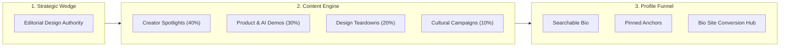
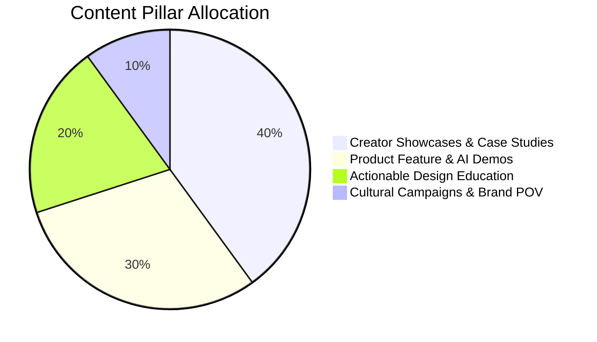
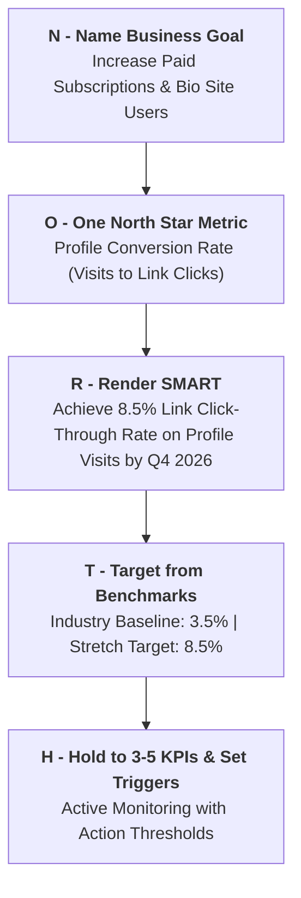
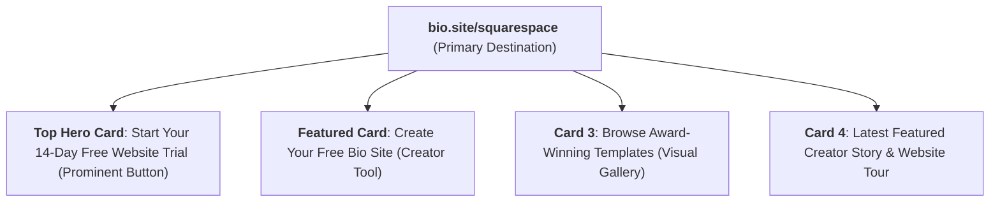
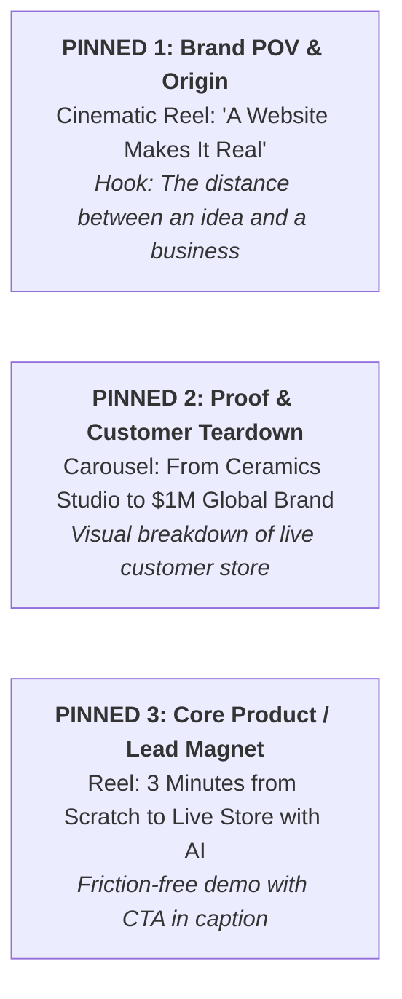

# Squarespace: Social Strategy, Goals & Profile Optimization

*Brand*: **Squarespace**  
*Primary Channel*: **Instagram ([@squarespace](https://www.instagram.com/squarespace/?hl=en))**  
*Last Updated*: August 30, 2026 | *Status*: Active Strategic Plan

---

## Executive Overview

This document defines the overarching social media strategy, quantifiable business-goal cascades (NORTH framework), and a tactical profile optimization blueprint for **Squarespace**.

While Squarespace enjoys immense cultural brand awareness, social media must perform as a **direct conversion engine** that turns passive visual admiration into qualified free trial sign-ups, website launches, and `Bio Sites` creator adoption.

---

# Part 1: Social Media Strategy



## 1.1 Core Strategic Objective
- **Primary Objective**: **Qualified Consideration & Product Adoption** (Driving profile visitors to launch websites and claim free `bio.site` links).
- **Secondary Objective**: **Brand Authority & Cultural Elevation** (Cementing Squarespace as the undeniable benchmark for aesthetic design in digital commerce).

## 1.2 The Strategic Wedge
> **The Wedge**: *"Design as a Commercial Superpower."*  
> While competitors treat websites as mere transactional utility forms or complex code repositories, Squarespace frames design elegance as the fundamental credibility multiplier for any modern business.

## 1.3 Channel Role Matrix & Focus

| Channel | Priority | Strategic Role | Primary Format | Cadence |
| :--- | :--- | :--- | :--- | :--- |
| **Instagram** (`@squarespace`) | **Tier 1 (Flagship)** | Visual proof, creator storytelling, brand aesthetic anchor, bio link gateway. | Reels, High-Design Carousels, Stories | 4–5 posts / week |
| **YouTube** | **Tier 2 (Search/Education)** | Deep-dive tutorials, Fluid Engine masterclasses, long-form creator documentaries. | 8–15 min Walkthroughs & Shorts | 1 long-form + 2 Shorts / week |
| **TikTok** | **Tier 2 (Top-of-Funnel)** | Relatable creative struggles, fast website build time-lapses, Bio Site hacks. | 15–45s Raw / Lo-Fi Vertical Video | 3–4 videos / week |
| **LinkedIn** | **Tier 3 (Enterprise/B2B)** | Commerce milestones, leadership perspectives, agency partner highlights. | Image + Thought Leadership Copy | 2 posts / week |

## 1.4 Content Pillars & Weekly Cadence



1. **Pillar 1: Creator Spotlights & Case Studies (40%)**
   - *Goal*: Tangible proof of real businesses winning on Squarespace.
   - *Formats*: Workspace-to-website video transitions, "How this ceramist/architect scaled to $500k" interviews.
2. **Pillar 2: Product & Fluid Engine Demos (30%)**
   - *Goal*: Demystifying customization and showcasing speed of building.
   - *Formats*: 30-second screen-capture Reels showing drag-and-drop customization, AI design generation, mobile responsive editing.
3. **Pillar 3: Actionable Design & Conversion Education (20%)**
   - *Goal*: High save-rate educational carousels that establish authority.
   - *Formats*: Multi-slide teardowns ("5 Typography Rules for High-Converting Landing Pages", "How to Structure an Art Portfolio").
4. **Pillar 4: Cultural Campaigns & Brand POV (10%)**
   - *Goal*: Emotional resonance and top-of-mind recall.
   - *Formats*: Cinematic vignettes with celebrity collaborators, Webby/Design Award winners.

---

# Part 2: Goals, KPIs & Target Setting (NORTH Framework)



## 2.1 The Goal Cascade

$$\text{Business Goal: SaaS Subscription Growth} \longrightarrow \text{Social Objective: Profile Traffic \& Action} \longrightarrow \text{North Star: Profile CVR}$$

## 2.2 SMART Targets & KPI Scorecard

| Level | Metric | Baseline | Target (Q4 2026) | Measurement Tool | Review Cycle |
| :--- | :--- | :--- | :--- | :--- | :--- |
| **North Star** | **Profile Conversion Rate** *(Profile Visits $\rightarrow$ Bio Site Clicks)* | ~3.2% | **8.5%** | Instagram Insights + Bio Site Analytics | Weekly |
| **Leading** | **Educational Carousel Saves & Shares** | 250 avg / post | **1,200 avg / post** | Instagram Native Insights | Per Post |
| **Leading** | **Reels Completion Rate (3-sec+ Retention)** | 22% | **42%** | Instagram Video Analytics | Weekly |
| **Lagging** | **Trial Sign-ups Initiated via Bio Link** | 4,500 / mo | **12,000 / mo** | UTM Tracking / GA4 / Stripe | Monthly |
| **Quality Floor** | **Engagement Rate on Follower Base** | 0.45% | **> 0.85%** | Native IG Insights | Monthly |

## 2.3 Action Triggers & Contingencies
- ⚠️ **Trigger 1**: *If Profile Visits surge by >30% (from a viral Reel) but Link Clicks stay flat (<2%)* $\rightarrow$ **Action**: Swap the primary bio CTA to a direct free template lead magnet instead of the general homepage.
- ⚠️ **Trigger 2**: *If Save Rate drops below 0.3% on Carousels* $\rightarrow$ **Action**: Refocus slides from high-level brand appreciation to dense, step-by-step design checklists.

---

# Part 3: Profile Optimization Blueprint

```
+-------------------------------------------------------------------+
|  [ @squarespace ]  ✓                                              |
|  Squarespace | Website Builder & Commerce                         |
|                                                                   |
|  Everything to sell anything.                                     |
|  Empowering 5M+ creators with world-class web design & commerce.  |
|  Claim your free Bio Site or start your 14-day trial 👇          |
|                                                                   |
|  🔗 bio.site/squarespace                                          |
+-------------------------------------------------------------------+
|  [Edit Profile]      [Share Profile]      [Contact]               |
+-------------------------------------------------------------------+
|  (⚡ Start Here)  (🎨 Templates)  (🏆 Case Studies)  (📱 Bio Sites) |
+-------------------------------------------------------------------+
|  [📌 Pinned 1: Origin]   [📌 Pinned 2: Proof]   [📌 Pinned 3: Offer] |
+-------------------------------------------------------------------+
```

## 3.1 Searchable Name Field Optimization
*Instagram indexes the Name field in in-app search queries. Duplicating just the brand name loses valuable keyword real estate.*

- ❌ **Current / Generic**: `Squarespace`
- ✅ **Optimized Option 1 (Recommended - SEO Focus)**: `Squarespace | Website Builder & Commerce`
- ✅ **Optimized Option 2 (Creator / Design Focus)**: `Squarespace | Design, Websites & Bio Sites`
- ✅ **Optimized Option 3 (E-Commerce Focus)**: `Squarespace | Build & Sell Online`

---

## 3.2 High-Converting Bio Copy Variations

### Option A: The Authority & Creator Stack (Recommended)
```text
Everything to sell anything.
Empowering 5M+ entrepreneurs & designers with world-class websites.
Claim your free link-in-bio or start your 14-day free trial 👇
🔗 bio.site/squarespace
```
* **Character Count**: 144 / 150 (Strictly compliant)
* **Structure**: Category Hook $\rightarrow$ Social Proof $\rightarrow$ Direct Frictionless CTA.

### Option B: The Contrarian Design Wedge
```text
A website makes it real.
Because world-class brands shouldn't look like generic templates.
Turn your creative vision into an online business 👇
🔗 bio.site/squarespace
```
* **Character Count**: 141 / 150
* **Structure**: Brand Mantra $\rightarrow$ Value Differentiator $\rightarrow$ Outcome-driven Action.

### Option C: The Product & Feature Stack
```text
All-in-one platform for websites, domains, commerce & scheduling.
Award-winning design made effortless with Fluid Engine & AI.
Explore free templates & creator tools 👇
🔗 bio.site/squarespace
```
* **Character Count**: 148 / 150
* **Structure**: Utility Scope $\rightarrow$ Tech Innovation Proof $\rightarrow$ Low-barrier CTA.

---

## 3.3 Link-in-Bio & CTA Architecture (`bio.site/squarespace`)

The primary link must not become an uncurated list. It should feature a clean visual hierarchy using Squarespace's own `Bio Sites` engine:



- **Primary Button Prompt**: *"Start Building with 14 Days Free"*
- **Secondary Card**: *"Claim Your Custom Bio.site Link in 60 Seconds"*
- **Tertiary Card**: *"Explore 2026 Trending Website Templates"*

---

## 3.4 Pinned Posts Architecture (The 3 Intentional Anchors)

Control the immediate visual first impression when visitors land on the profile:



1. **Pinned Post 1 (The Brand Wedge / Origin Story)**:
   - *Format*: High-production 45s cinematic manifesto video.
   - *Message*: Why visual design is the core difference between a hobby and a legitimate brand.
2. **Pinned Post 2 (The Customer Proof / Revenue Case Study)**:
   - *Format*: 8-slide educational teardown carousel.
   - *Message*: Deep dive into how a boutique creator built a 6-figure business using Squarespace e-commerce and marketing tools.
3. **Pinned Post 3 (The Low-Barrier Product Demo / Starter Kit)**:
   - *Format*: Split-screen Reel showing real-time mobile and desktop setup using Fluid Engine.
   - *CTA*: "Comment 'TEMPLATE' or tap link in bio to start free."

---

## 3.5 Story Highlights Architecture & Taxonomy

Replace scattered story archives with a structured, permanent product navigation system with minimalist black-on-white custom icon covers:

| Highlight Title | Content Function | Example Story Assets |
| :--- | :--- | :--- |
| **⚡ Start Here** | Onboarding guide for new visitors & entrepreneurs. | "How to choose your template", "3 steps to launch", "Domain setup 101". |
| **🎨 Templates** | Interactive showcase of trending website themes. | Swipe-up / Sticker links directly to individual responsive templates. |
| **🏆 Stories** | Authentic user spotlights and client testimonials. | Creator interviews, unboxing packaging, storefront walkthroughs. |
| **📱 Bio Sites** | Promotion and tutorials for the link-in-bio tool. | Quick customization tips, aesthetic layout examples for creators. |
| **💡 Tips & Hacks** | Bite-sized design and SEO recommendations. | "How to optimize images for speed", "Typography pairings that convert". |

---

## Summary & Implementation Checklist

- [x] **Strategic Alignment**: Shift social from passive portfolio gallery to active lead and trial generation.
- [x] **NORTH Goal Tracking**: Set 8.5% profile conversion rate as the primary channel North Star.
- [x] **SEO Discovery**: Upgrade Name field to include high-intent keywords (`Website Builder & Commerce`).
- [x] **Bio Clarity**: Implement 144-character authority stack with direct CTA.
- [x] **Conversion Hub**: Restructure `bio.site/squarespace` hierarchy to prioritize free trial activation.
- [x] **Grid Anchors**: Produce 3 dedicated pinned posts (Manifesto, Case Study, AI Demo).
- [x] **Highlights System**: Deploy 5 standardized highlight pillars with clean branded covers.
